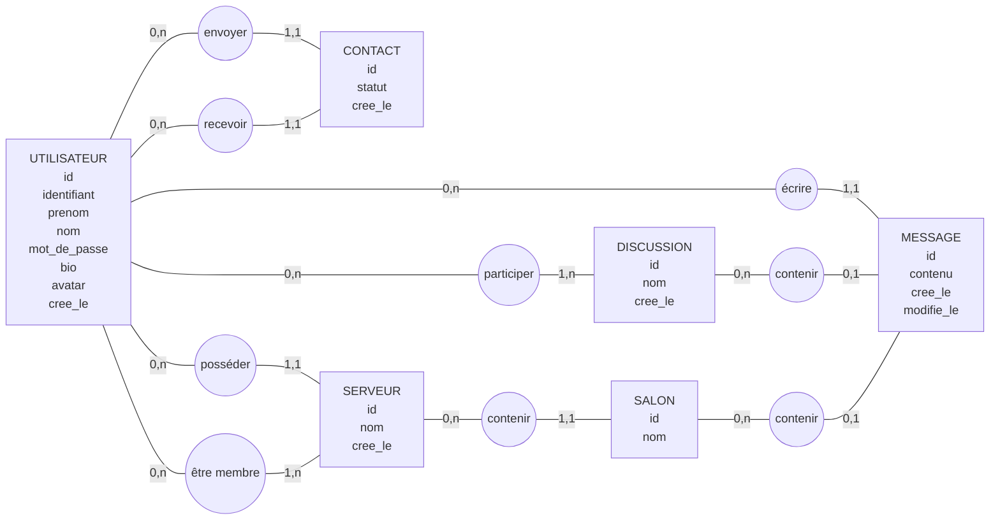

# Y - Messages : guide technique

**Y - Messages** est une application de messagerie inspirée de Discord, développée avec **Symfony 8**.
Ce guide détaille l'installation, la structure du code et le dépannage. La présentation du projet se trouve dans le [README principal](../README.md).

---

## Sommaire

1. [Fonctionnalités](#1-fonctionnalités)
2. [Technologies utilisées](#2-technologies-utilisées)
3. [Prérequis](#3-prérequis)
4. [Installation pas à pas](#4-installation-pas-à-pas)
5. [Comptes de démonstration](#5-comptes-de-démonstration)
6. [Lancer le projet au quotidien](#6-lancer-le-projet-au-quotidien)
7. [Structure du projet](#7-structure-du-projet)
8. [Base de données](#8-base-de-données)
9. [Liste des pages (routes)](#9-liste-des-pages-routes)
10. [Dépannage](#10-dépannage)
11. [Perspectives d'amélioration](#11-perspectives-damélioration)

---

## 1. Fonctionnalités

| Domaine | Ce qu'on peut faire | CRUD |
|---|---|---|
| **Compte** | Inscription (prénom, nom, mot de passe), connexion, déconnexion | C |
| **Identifiant** | Créé automatiquement : 1ʳᵉ lettre du prénom + `_` + 3 lettres du nom (Alice Martin → `a_mar`), modifiable ensuite | C / U |
| **Profil** | Voir son profil ou celui des autres, modifier son nom, son identifiant, sa bio, son avatar et son mot de passe, supprimer son compte | R / U / D |
| **Contacts** | Envoyer une demande d'ami par identifiant, accepter, refuser, annuler, retirer un ami | C / R / U / D |
| **Messages privés** | Discussion à deux avec un ami | C / R / D |
| **Groupes** | Discussion à plusieurs, renommer, ajouter des amis, quitter | C / R / U / D |
| **Serveurs** | Créer (avec un salon `#général`), renommer, supprimer, inviter ou retirer des membres, quitter | C / R / U / D |
| **Salons** | Créer, renommer et supprimer des salons dans un serveur | C / R / U / D |
| **Messages** | Envoyer, modifier (affiche « (modifié) ») et supprimer ses messages | C / R / U / D |
| **Temps réel** | Les nouveaux messages apparaissent tout seuls (rafraîchissement toutes les 3 s) | – |
| **Responsive** | Utilisable sur ordinateur, tablette et téléphone (voir ci-dessous) | – |

Sécurité : toutes les pages demandent d'être connecté (sauf connexion et inscription). Les mots de passe sont hashés et les formulaires protégés contre le CSRF. On ne peut voir que les discussions et serveurs dont on est membre.

---

## 2. Technologies utilisées

| Outil | Rôle |
|---|---|
| **PHP 8.4** + **Symfony 8.1** | Framework back-end (contrôleurs, routes, sécurité, formulaires) |
| **Doctrine ORM** | Lien entre les classes PHP (entités) et les tables MySQL |
| **Twig** | Moteur de templates (les pages HTML) |
| **MySQL 8.4** (via **Docker**) | Base de données |
| **phpMyAdmin** (via Docker) | Interface web pour voir la base |
| **Bootstrap 5.3** | Composants : boutons, formulaires, alertes, menus, tiroirs (offcanvas) du mode téléphone |
| **Tailwind CSS 3** | Mise en page et couleurs (classes préfixées `tw-`), variantes `sm:` / `md:` / `lg:` pour le responsive |
| **JavaScript** (sans framework) | Rafraîchissement automatique des messages |

Bootstrap et Tailwind sont chargés par CDN : pas besoin de Node.js ni de npm.

### Affichage selon la taille de l'écran

| Écran | Largeur | Affichage |
|---|---|---|
| **Ordinateur** | 992 px et plus | Les 4 colonnes façon Discord : serveurs, barre latérale, conversation, membres |
| **Tablette** | 768 à 991 px | Serveurs, barre latérale et conversation ; les membres s'ouvrent avec le bouton <i>membres</i> de l'en-tête |
| **Téléphone** | moins de 768 px | Seule la conversation est affichée ; le bouton ☰ ouvre les serveurs et les discussions dans un tiroir |

Sur écran tactile, les boutons qui n'apparaissent qu'au survol sur ordinateur (modifier un message, gérer un salon, retirer un membre) restent toujours visibles, puisqu'on ne peut pas survoler avec le doigt.

---

## 3. Prérequis

À installer une seule fois sur ton PC :

- [PHP 8.4](https://windows.php.net/download/) avec les extensions `pdo_mysql`, `intl` et `mbstring`
- [Composer](https://getcomposer.org/download/)
- [Symfony CLI](https://symfony.com/download)
- [Docker Desktop](https://www.docker.com/products/docker-desktop/)

Pour vérifier, lance dans un terminal :

```bash
php -v
```
```bash
composer -V
```
```bash
symfony version
```
```bash
docker --version
```

---

## 4. Installation pas à pas

Toutes les commandes se lancent **dans le dossier du projet** (`y-messages`).

**1. Installer les dépendances PHP** (dossier `vendor/`) :

```bash
composer install
```

**2. Démarrer Docker Desktop.** Ouvre l'application et attends que la baleine en bas à gauche soit verte (« Engine running »).

**3. Lancer la base de données** (MySQL + phpMyAdmin) :

```bash
docker compose up -d
```

Au tout premier lancement, Docker télécharge MySQL (quelques minutes) puis exécute automatiquement les scripts SQL du dossier `database/` : création des tables et ajout des données de démo.

**4. Vérifier que Symfony voit bien la base** :

```bash
php bin/console doctrine:schema:validate
```

Les deux lignes doivent être `[OK]`. Si la ligne *Database* est en erreur, attends 20 secondes, le temps que MySQL finisse de démarrer, puis relance la commande.

**5. Lancer le serveur web Symfony** :

```bash
symfony serve -d
```

**6. Ouvrir l'application** : <http://127.0.0.1:8000>. Si le port 8000 est déjà pris (par un autre projet), Symfony en choisit un autre, comme 8001 : utilise l'adresse affichée par la commande.

Pour voir la base de données : <http://localhost:8081> (phpMyAdmin, utilisateur `ymessages`, mot de passe `ymessages`).

---

## 5. Comptes de démonstration

Tous ces comptes ont le mot de passe **`motdepasse`** :

| Identifiant | Nom | Situation |
|---|---|---|
| `a_mar` | Alice Martin | Amie avec Bob et Chloé, propriétaire du serveur *Gaming*, a reçu une demande de David |
| `b_dup` | Bob Dupont | Ami avec Alice et Chloé |
| `c_ber` | Chloé Bernard | Amie avec Alice et Bob |
| `d_ler` | David Leroy | A envoyé une demande d'ami à Alice |

💡 Pour tester le « temps réel », ouvre deux navigateurs (ou une fenêtre de navigation privée), connecte-toi avec deux comptes différents et discute.

---

## 6. Lancer le projet au quotidien

| Action | Commande |
|---|---|
| Démarrer la base | `docker compose up -d` |
| Démarrer le site | `symfony serve -d` |
| Arrêter le site | `symfony server:stop` |
| Arrêter la base (les données sont gardées) | `docker compose stop` |
| **Remettre la base à zéro** (supprime tout puis relance les scripts SQL) | `docker compose down -v` puis `docker compose up -d` |
| Voir les logs de Symfony | `symfony server:log` |
| Vider le cache | `php bin/console cache:clear` |

---

## 7. Structure du projet

```
y-messages/
├── compose.yaml              # Docker : MySQL + phpMyAdmin
├── .env                      # Configuration (adresse de la base de données)
├── database/                 # Scripts SQL exécutés par Docker au 1er lancement
│   ├── 01_schema.sql         #   création des tables
│   └── 02_donnees_demo.sql   #   comptes et messages de test
├── config/
│   └── packages/
│       ├── security.yaml     # Connexion, déconnexion, pages protégées
│       ├── doctrine.yaml     # Configuration de la base
│       └── twig.yaml         # Thème Bootstrap pour les formulaires
├── public/                   # Seul dossier accessible depuis le navigateur
│   ├── css/app.css           # Couleurs Discord + quelques classes maison
│   ├── js/chat.js            # Rafraîchissement automatique des messages
│   └── uploads/avatars/      # Images de profil envoyées
├── src/
│   ├── Controller/           # Reçoivent les requêtes et renvoient les pages
│   │   ├── SecurityController.php     # /connexion, /deconnexion
│   │   ├── InscriptionController.php  # /inscription
│   │   ├── ContactController.php      # / (amis), demandes d'ami
│   │   ├── DiscussionController.php   # MP et groupes
│   │   ├── ServeurController.php      # serveurs et membres
│   │   ├── SalonController.php        # salons
│   │   ├── MessageController.php      # modifier / supprimer un message
│   │   └── ProfilController.php       # profil, avatar, suppression du compte
│   ├── Entity/               # Les classes PHP = les tables de la base
│   │   ├── Utilisateur.php, Contact.php, Discussion.php
│   │   └── Serveur.php, Salon.php, Message.php
│   ├── Form/                 # Les formulaires Symfony
│   │   ├── InscriptionType.php, ProfilType.php, MessageType.php
│   │   └── NomType.php, NouvelleDiscussionType.php
│   ├── Repository/           # Les requêtes vers la base (une classe par entité)
│   └── Service/
│       └── GenerateurIdentifiant.php  # Fabrique "a_mar" à partir du prénom et du nom
└── templates/                # Les pages HTML (Twig)
    ├── base.html.twig        # Squelette HTML + Bootstrap + Tailwind
    ├── layout_app.html.twig  # Mise en page Discord (4 colonnes, tiroirs sur téléphone)
    ├── _partials/            # Morceaux réutilisés (avatar, chat, barres latérales...)
    ├── security/             # Connexion et inscription
    ├── contact/              # Page Amis
    ├── discussion/, salon/, serveur/, message/, profil/
```

---

## 8. Base de données

### MCD (modèle conceptuel de données)



**Comment le lire :** dans chaque entité, le premier attribut (`id`) est l'identifiant (il serait souligné sur papier). Les cardinalités se lisent « min, max » : `0,n` = zéro ou plusieurs, `1,1` = exactement un, `1,n` = au moins un. Exemple : un utilisateur peut envoyer `0,n` demandes d'ami, mais un contact a `1,1` seul demandeur.

Deux règles qu'on ne voit pas sur le schéma :

- un message appartient **soit** à une discussion, **soit** à un salon (jamais les deux, jamais aucun) — d'où le `0,1` des deux côtés ;
- une discussion vide est supprimée, d'où le `1,n` côté « participer » ;
- un serveur peut se retrouver sans salon si son propriétaire les supprime tous, d'où le `0,n` côté « contenir ».

### Les tables

Les relations « plusieurs à plusieurs » (*participer* et *être membre*) deviennent des tables de liaison en base : `discussion_utilisateur` et `serveur_utilisateur`. Les autres relations deviennent des clés étrangères.

| Table | Contenu |
|---|---|
| `utilisateur` | Comptes (identifiant unique, prénom, nom, mot de passe hashé, bio, avatar) |
| `contact` | Liens d'amitié : `demandeur_id`, `destinataire_id`, `statut` (`en_attente` ou `accepte`) |
| `discussion` | MP (`nom` vide) ou groupe (`nom` rempli) |
| `discussion_utilisateur` | Membres de chaque discussion |
| `serveur` | Serveurs, avec leur propriétaire |
| `serveur_utilisateur` | Membres de chaque serveur |
| `salon` | Salons d'un serveur |
| `message` | Messages, liés soit à une `discussion`, soit à un `salon` |

Les scripts SQL complets et commentés sont dans [`database/`](database/).

**Modifier la base plus tard :** si tu ajoutes un champ dans une entité, lance `php bin/console make:migration` puis `php bin/console doctrine:migrations:migrate`. Symfony génère et exécute lui-même le SQL nécessaire.

---

## 9. Liste des pages (routes)

| URL | Page / action |
|---|---|
| `/connexion` · `/inscription` · `/deconnexion` | Compte |
| `/` | Accueil : amis et demandes d'ami |
| `/amis/ajouter` · `/amis/{id}/accepter` · `/amis/{id}/supprimer` | Gérer les contacts (POST) |
| `/discussions/nouvelle` | Créer un MP ou un groupe |
| `/discussions/mp/{id}` | Ouvrir le MP avec un ami |
| `/discussions/{id}` | Lire et écrire dans une discussion |
| `/discussions/{id}/modifier` · `/ajouter-membre` · `/quitter` | Gérer un groupe |
| `/serveurs/nouveau` · `/serveurs/{id}` · `/modifier` · `/supprimer` · `/quitter` | Serveurs |
| `/serveurs/{id}/membres/ajouter` · `/membres/{membreId}/retirer` | Membres d'un serveur |
| `/serveurs/{id}/salons/nouveau` · `/salons/{id}` · `/modifier` · `/supprimer` | Salons |
| `/messages/{id}/modifier` · `/messages/{id}/supprimer` | Modifier ou supprimer un message |
| `/discussions/{id}/messages` · `/salons/{id}/messages` | Liste des messages seule (auto-refresh) |
| `/profil` · `/profil/{id}` · `/profil/modifier` · `/profil/supprimer` | Profil |

Pour voir toutes les routes : `php bin/console debug:router`

---

## 10. Dépannage

| Problème | Solution |
|---|---|
| `An exception occurred in the driver: SQLSTATE[HY000] [2002]` | MySQL n'est pas lancé : démarre Docker Desktop puis `docker compose up -d`. |
| `docker: failed to connect to the docker API` | Docker Desktop n'est pas démarré, ou démarre encore : attends que la baleine soit verte. |
| `port is already allocated` (3306 ou 8081) | Un autre MySQL (XAMPP, WAMP...) utilise déjà ce port : arrête-le, ou change `"3306:3306"` en `"3307:3306"` dans `compose.yaml` et `127.0.0.1:3306` en `127.0.0.1:3307` dans `.env`. |
| Les comptes de démo n'existent pas | Les scripts SQL ne s'exécutent qu'au **premier** démarrage. Remets la base à zéro : `docker compose down -v` puis `docker compose up -d`. |
| `Table ... doesn't exist` | Même solution que ci-dessus. |
| Le style ne s'affiche pas | Bootstrap et Tailwind viennent d'Internet (CDN) : vérifie ta connexion. |
| Page blanche ou erreur bizarre | `php bin/console cache:clear` |
| `cache:clear` : `Permission denied` | Le projet est dans OneDrive, qui verrouille des fichiers pendant la synchronisation. Relance la commande, ou supprime le dossier `var/cache`. Le mieux reste de mettre le projet **hors de OneDrive** (ex. `C:\dev\y-messages`). |
| Docker Desktop affiche « An unexpected error occurred » avec `sailor-ingest.sock` ou `engine.sock` : *The file cannot be accessed by the system* | Un ancien fichier socket bloque le démarrage. Quitte Docker Desktop, renomme les dossiers `%LOCALAPPDATA%\Docker\run` et `%LOCALAPPDATA%\docker-secrets-engine` (par ex. en `run_ancien`), puis relance Docker Desktop. Docker les recrée tout seul. |

---

## 11. Perspectives d'amélioration

Le projet couvre l'essentiel de Discord, mais plusieurs évolutions permettraient de le rapprocher d'une application en production.

### Fonctionnalités

| Amélioration | Intérêt | Piste technique |
|---|---|---|
| **Vrai temps réel** | Aujourd'hui, chaque page ouverte interroge le serveur toutes les 3 s, même sans nouveau message. | Mercure (intégré à Symfony) ou WebSockets : le serveur prévient les navigateurs à l'arrivée d'un message. |
| **Messages non lus** | Savoir où il y a du nouveau sans ouvrir chaque discussion. | Mémoriser le dernier message lu par chaque membre et afficher un compteur dans la barre latérale. |
| **Rôles dans un serveur** | Seul le propriétaire peut gérer le serveur ; impossible de nommer des modérateurs. | Remplacer la table `serveur_utilisateur` par une entité `MembreServeur` avec un champ `role`. |
| **Codes d'invitation** | Pour rejoindre un serveur, il faut être ami avec son propriétaire. | Lien d'invitation unique (et éventuellement à durée limitée) par serveur. |
| **Pagination des messages** | Toute la conversation est chargée à chaque affichage, ce qui ralentira avec des milliers de messages. | Charger les 50 derniers, puis les plus anciens en remontant. |
| **Messages enrichis** | Messages en texte brut uniquement. | Images et fichiers joints, réactions emoji, réponses à un message, mentions `@identifiant`. |
| **Présence** | On ne sait pas qui est connecté. | Statut « en ligne / absent » et indicateur « est en train d'écrire ». |
| **Recherche et blocage** | Pas de recherche dans l'historique, pas de protection contre un utilisateur gênant. | Recherche `LIKE` (ou index plein texte) et liste d'utilisateurs bloqués. |
| **Application mobile** | Le site est responsive, mais il faut l'ouvrir dans le navigateur et il ne prévient pas des nouveaux messages. | En faire une PWA (installable sur l'écran d'accueil) avec des notifications push. |

### Qualité et sécurité

| Amélioration | Intérêt | Piste technique |
|---|---|---|
| **Tests automatisés** | Vérifier que rien ne casse à chaque modification. | PHPUnit avec `WebTestCase` pour chaque contrôleur (accès refusé, envoi de message...). |
| **Voters Symfony** | Les vérifications `verifierMembre()` sont répétées dans plusieurs contrôleurs. | Centraliser les droits dans des Voters et utiliser `#[IsGranted]`. |
| **Contrainte en base** | La règle « un message est dans une discussion **ou** un salon » n'est garantie que par le code. | Contrainte `CHECK` en SQL sur `discussion_id` / `salon_id`. |
| **Auto-refresh plus léger** | Le polling renvoie toute la liste des messages à chaque fois. | Ne renvoyer que les messages postés après le dernier reçu. |
| **Protection de la connexion** | Rien n'empêche de tester des milliers de mots de passe. | `login_throttling` de Symfony et règles de mot de passe plus strictes. |
| **Assets en local** | Bootstrap et Tailwind viennent d'un CDN : le site dépend d'Internet, et le CDN de Tailwind est déconseillé en production. | AssetMapper de Symfony et compilation de Tailwind. |
| **Une seule source pour le schéma** | La structure existe à la fois dans les entités et dans `01_schema.sql`. | Utiliser uniquement les migrations Doctrine et garder le SQL pour les données de démo. |
| **Déploiement** | PHP doit être installé sur la machine. | Ajouter un conteneur PHP (FrankenPHP) pour tout lancer avec `docker compose up`. |
