# Conception et exploitation d'une base de données

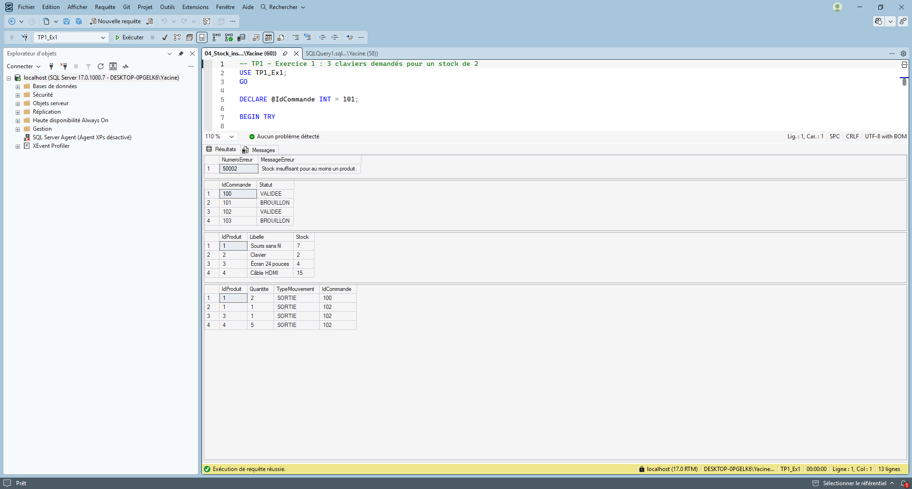

> Travaux pratiques de 2ème année à l'EPSI Lille sur **SQL Server** : transactions et gestion des erreurs, procédures stockées, fonctions, curseurs et triggers. Chaque script est fourni avec la capture de son exécution dans **SQL Server Management Studio**.

---

## Sommaire

- [Introduction](#introduction)
- [Technologies utilisées](#technologies-utilisées)
- [Lancer les scripts](#lancer-les-scripts)
- [TP1 : Transactions et gestion des erreurs](#tp1--transactions-et-gestion-des-erreurs)
- [TP2 : Procédures stockées](#tp2--procédures-stockées)
- [TP3 : Fonctions, curseurs et triggers](#tp3--fonctions-curseurs-et-triggers)
- [Arborescence du dépôt](#arborescence-du-dépôt)

---

## Introduction

Ce dépôt regroupe trois TP du module *Conception et exploitation d'une base de données*. Ils ne se limitent pas aux cas qui fonctionnent : chaque traitement est aussi testé avec des erreurs, pour vérifier l'état de la base après l'échec.

| TP | Sujet | Bases | Scripts | Document |
| --- | --- | --- | --- | --- |
| **TP1** | Transactions, `TRY...CATCH`, `COMMIT`, `ROLLBACK` | `TP1_Ex1` à `TP1_Ex5` | 26 | [PDF](Documents/TP1%20-%20Transaction%20et%20gestion%20des%20erreurs.pdf) |
| **TP2** | Procédures stockées, paramètres `OUTPUT`, `THROW` | `TP2` | 22 | [PDF](Documents/TP2%20-%20Les%20proc%C3%A9dures.pdf) |
| **TP3** | Fonctions scalaires et table, curseur, triggers | `TP3` | 23 | [PDF](Documents/TP3%20-%20Fonctions,%20curseurs%20et%20triggers.pdf) |

Le code des transactions du TP1 reprend le corrigé fourni en cours ; les jeux de tests sont ajoutés. Les TP2 et TP3 n'ont pas de corrigé : ils sont réalisés à partir de l'énoncé, avec le code le plus simple possible.

---

## Technologies utilisées

- **SQL Server 17.0** (Developer Edition) et **T-SQL**
- **SQL Server Management Studio 22** pour l'exécution et les captures

---

## Lancer les scripts

Les exercices du TP1 réutilisent les mêmes noms de tables (`Client`, `Commande`, `Paiement`...) : chacun a donc sa propre base.

Dans chaque dossier, les scripts s'exécutent **dans l'ordre de leur numéro**, car chaque test part de l'état laissé par le précédent. Le script `01` crée la base : relancé, il la supprime et repart de zéro.

> **Lire les captures** : le compteur rouge qui apparaît sur certaines captures en bas de l'éditeur vient d'IntelliSense, dont l'analyse n'est plus à jour une fois les objets créés. Il ne s'agit pas d'une erreur d'exécution : le résultat réel est indiqué dans la barre jaune. Les messages longs de la colonne `MessageErreur` sont coupés à l'affichage.

---

## TP1 : Transactions et gestion des erreurs

### Exercice 1 : Gestion d'un inventaire

Valider une commande met à jour son statut, les stocks et les mouvements de stock, sans jamais valider une commande partiellement.

| Script | Ce qui est testé | Résultat obtenu |
| --- | --- | --- |
| [`01_Creation.sql`](SQL/TP1/Ex1_Inventaire/01_Creation.sql) | Base, tables et données | 4 commandes en `BROUILLON` |
| [`02_Validation_reussie.sql`](SQL/TP1/Ex1_Inventaire/02_Validation_reussie.sql) | Commande 100, un seul produit | `VALIDEE`, stock de souris de 10 à 8, 1 mouvement |
| [`03_Plusieurs_produits.sql`](SQL/TP1/Ex1_Inventaire/03_Plusieurs_produits.sql) | Commande 102, trois produits | `VALIDEE`, 3 stocks diminués, 3 mouvements |
| [`04_Stock_insuffisant.sql`](SQL/TP1/Ex1_Inventaire/04_Stock_insuffisant.sql) | Commande 101, 3 claviers pour un stock de 2 | Erreur 50002, rien ne change, même pour la souris de la commande |
| [`05_Commande_inexistante.sql`](SQL/TP1/Ex1_Inventaire/05_Commande_inexistante.sql) | Commande 999 | Erreur 50001, rien ne change |
| [`06_Erreur_volontaire.sql`](SQL/TP1/Ex1_Inventaire/06_Erreur_volontaire.sql) | Erreur levée après la mise à jour du stock | Erreur 50099, le stock de l'écran reste à 4 |

<details>
<summary>Voir les captures</summary>

**01_Creation** : Base, tables et données

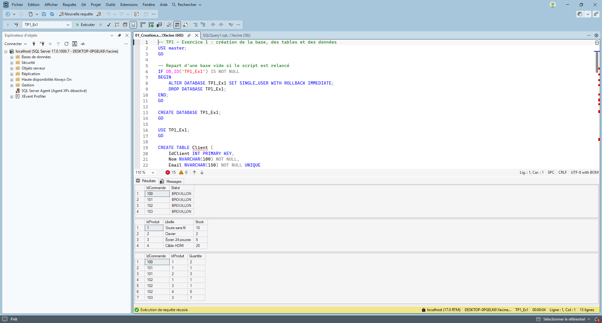

**02_Validation_reussie** : Commande 100, un seul produit

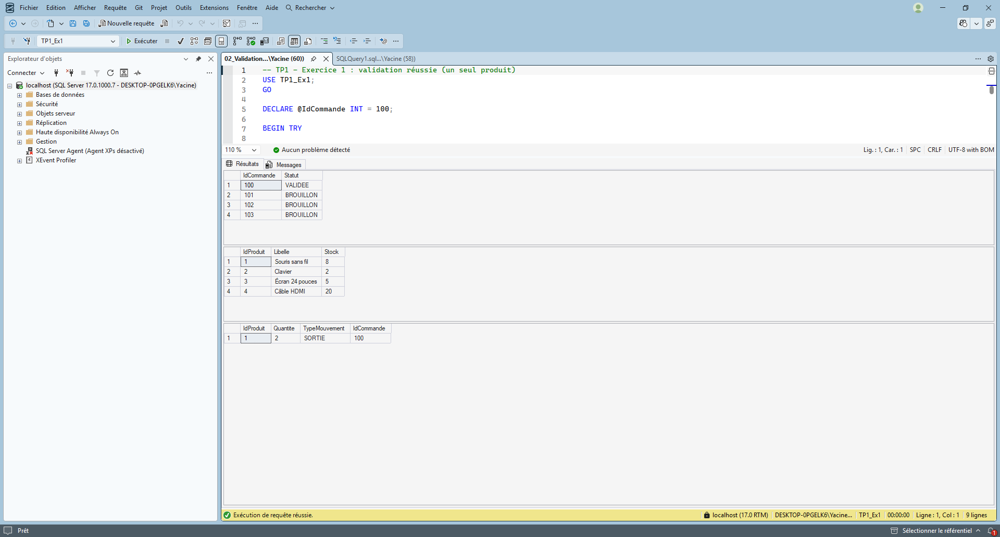

**03_Plusieurs_produits** : Commande 102, trois produits

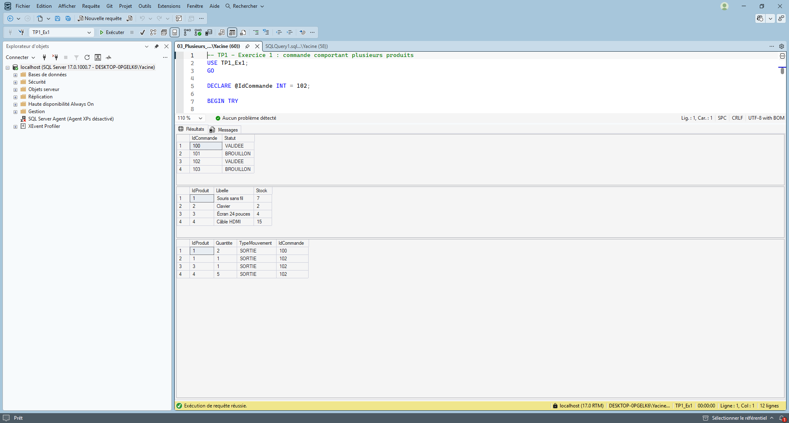

**04_Stock_insuffisant** : Commande 101, 3 claviers pour un stock de 2


**05_Commande_inexistante** : Commande 999

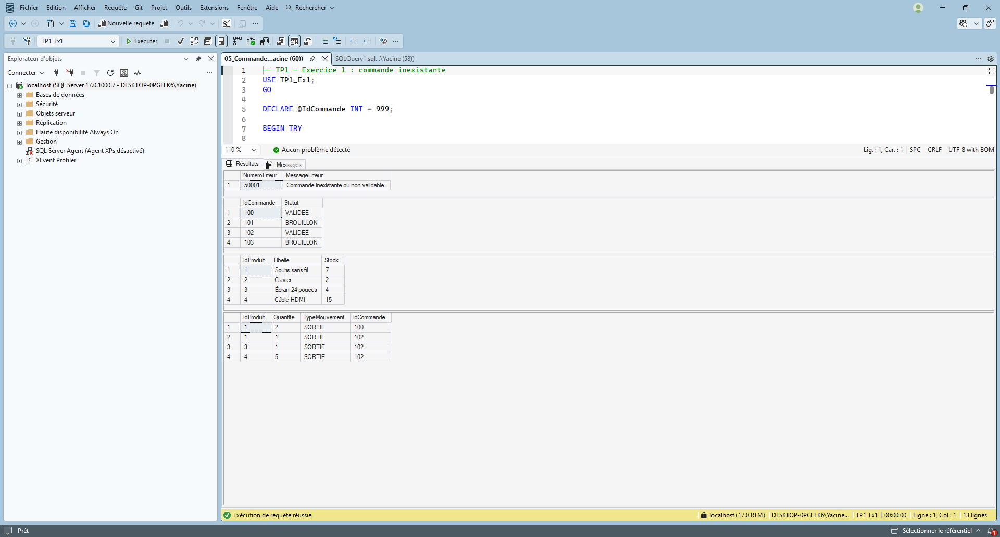

**06_Erreur_volontaire** : Erreur levée après la mise à jour du stock


</details>

**Analyse.** Une erreur sur une seule ligne ne doit rien laisser en base : sinon le stock du premier produit serait diminué pour une commande restée en `BROUILLON`, et l'inventaire serait faux. La transaction garantit que toutes les lignes sont traitées, ou aucune.

### Exercice 2 : Réservation de véhicules

| Script | Ce qui est testé | Résultat obtenu |
| --- | --- | --- |
| [`01_Creation.sql`](SQL/TP1/Ex2_Reservation/01_Creation.sql) | Base, tables et données | 3 réservations `EN_ATTENTE` |
| [`02_Reservation_valide.sql`](SQL/TP1/Ex2_Reservation/02_Reservation_valide.sql) | Réservation 100 | `CONFIRMEE`, véhicule `RESERVE`, paiement et historique créés |
| [`03_Vehicule_indisponible.sql`](SQL/TP1/Ex2_Reservation/03_Vehicule_indisponible.sql) | Réservation 101, véhicule en entretien | Erreur 50011, rien ne change |
| [`04_Reservation_inexistante.sql`](SQL/TP1/Ex2_Reservation/04_Reservation_inexistante.sql) | Réservation 999 | Erreur 50010, rien ne change |
| [`05_Donnee_incorrecte.sql`](SQL/TP1/Ex2_Reservation/05_Donnee_incorrecte.sql) | Date de fin avant la date de début | Erreur 547 (contrainte `CHECK`), réservation non créée |
| [`06_Erreur_apres_modifications.sql`](SQL/TP1/Ex2_Reservation/06_Erreur_apres_modifications.sql) | Erreur levée après 3 modifications | Erreur 50099, réservation 102 toujours `EN_ATTENTE`, aucun paiement |

<details>
<summary>Voir les captures</summary>

**01_Creation** : Base, tables et données

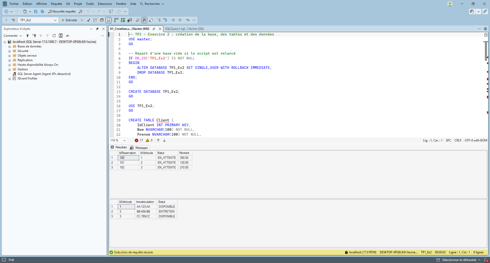

**02_Reservation_valide** : Réservation 100


**03_Vehicule_indisponible** : Réservation 101, véhicule en entretien

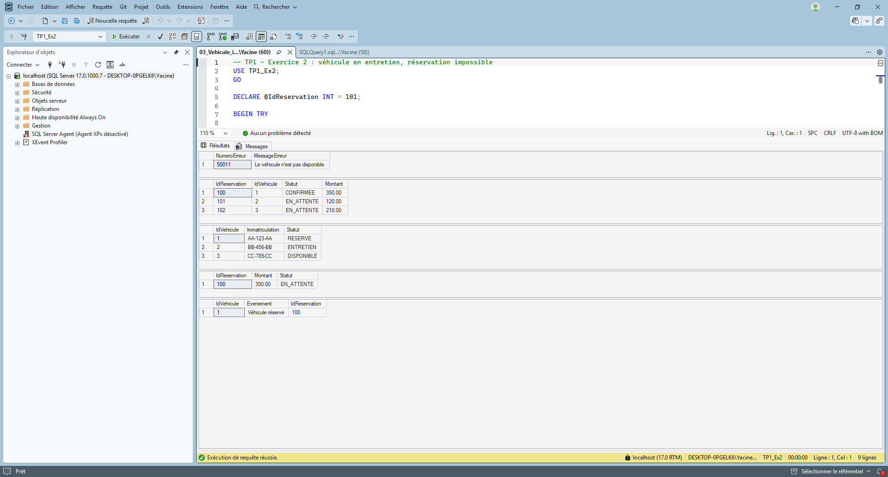

**04_Reservation_inexistante** : Réservation 999

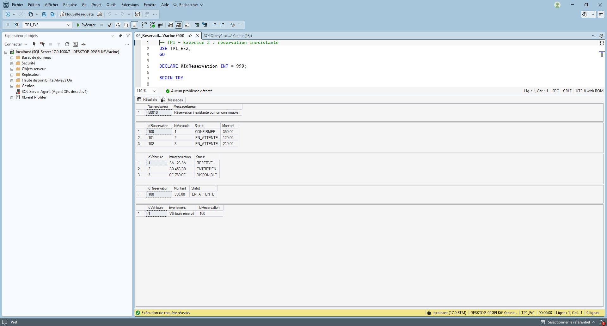

**05_Donnee_incorrecte** : Date de fin avant la date de début


**06_Erreur_apres_modifications** : Erreur levée après 3 modifications

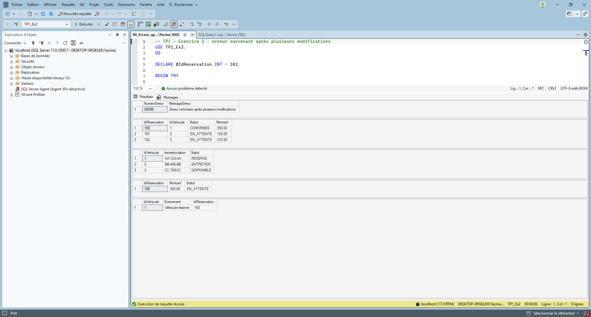

</details>

**Analyse.** Le statut `CONFIRMEE` n'est écrit que dans la transaction qui bloque aussi le véhicule, enregistre le paiement et trace l'historique. Le test `06` le montre : l'erreur survient après trois modifications, et le `ROLLBACK` les annule toutes. Une réservation ne peut donc pas être confirmée sans le reste.

### Exercice 3 : Transfert d'un client

| Script | Ce qui est testé | Résultat obtenu |
| --- | --- | --- |
| [`01_Creation.sql`](SQL/TP1/Ex3_Transfert_client/01_Creation.sql) | Base, tables et données | Martin à l'agence 1, Durand à l'agence 2 |
| [`02_Transfert_normal.sql`](SQL/TP1/Ex3_Transfert_client/02_Transfert_normal.sql) | Martin vers l'agence 2 | Ancienne affectation clôturée, nouvelle créée, fiche mise à jour |
| [`03_Client_inexistant.sql`](SQL/TP1/Ex3_Transfert_client/03_Client_inexistant.sql) | Client 999 | Erreur 50020, rien ne change |
| [`04_Agence_inexistante.sql`](SQL/TP1/Ex3_Transfert_client/04_Agence_inexistante.sql) | Agence 99 | Erreur 50021, rien ne change |
| [`05_Deja_rattache.sql`](SQL/TP1/Ex3_Transfert_client/05_Deja_rattache.sql) | Durand vers son agence actuelle | Erreur 50022, rien ne change |
| [`06_Erreur_volontaire.sql`](SQL/TP1/Ex3_Transfert_client/06_Erreur_volontaire.sql) | Erreur levée après l'écriture dans l'historique | Erreur 50099, Durand reste à l'agence 2, historique intact |

<details>
<summary>Voir les captures</summary>

**01_Creation** : Base, tables et données

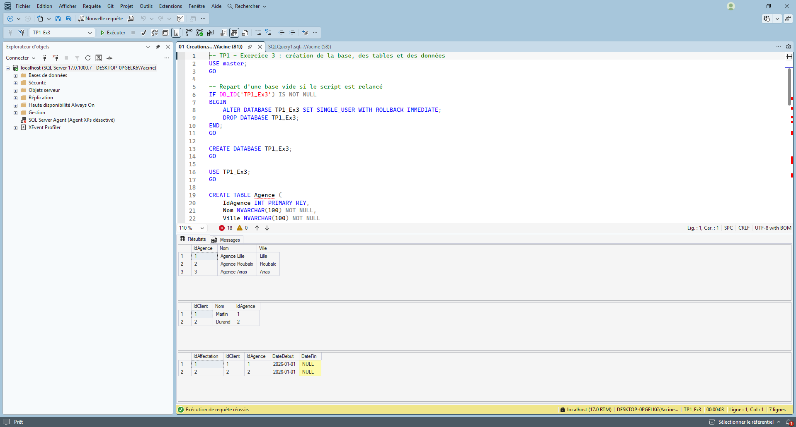

**02_Transfert_normal** : Martin vers l'agence 2

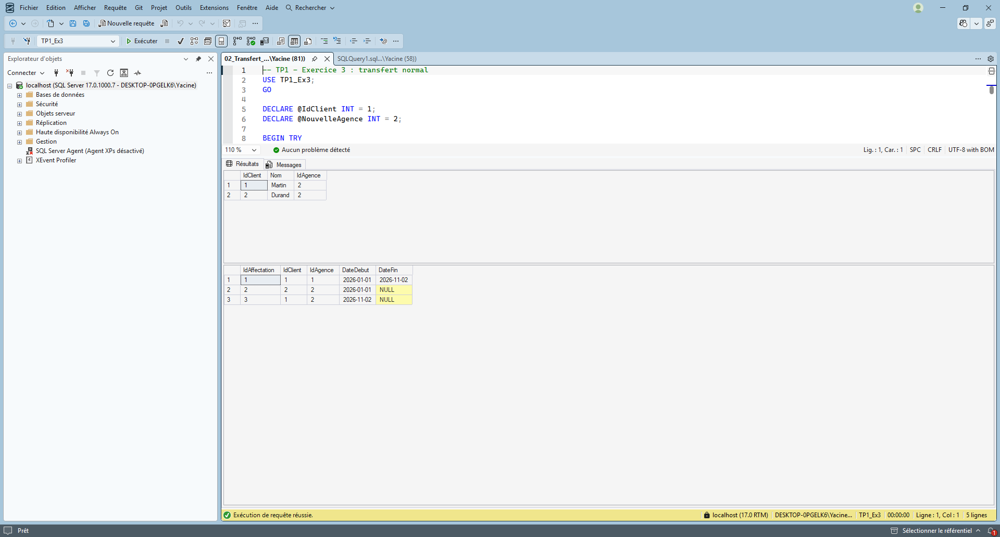

**03_Client_inexistant** : Client 999

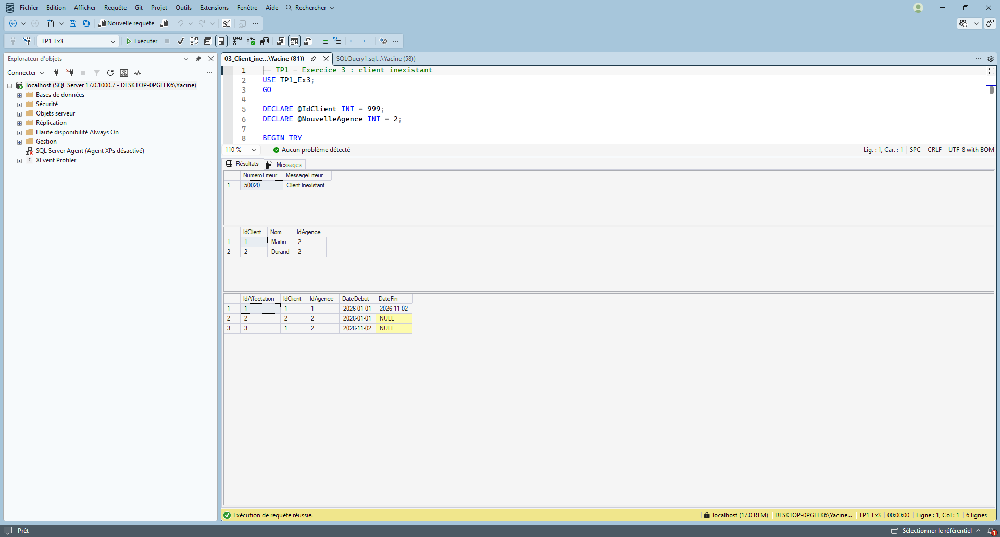

**04_Agence_inexistante** : Agence 99

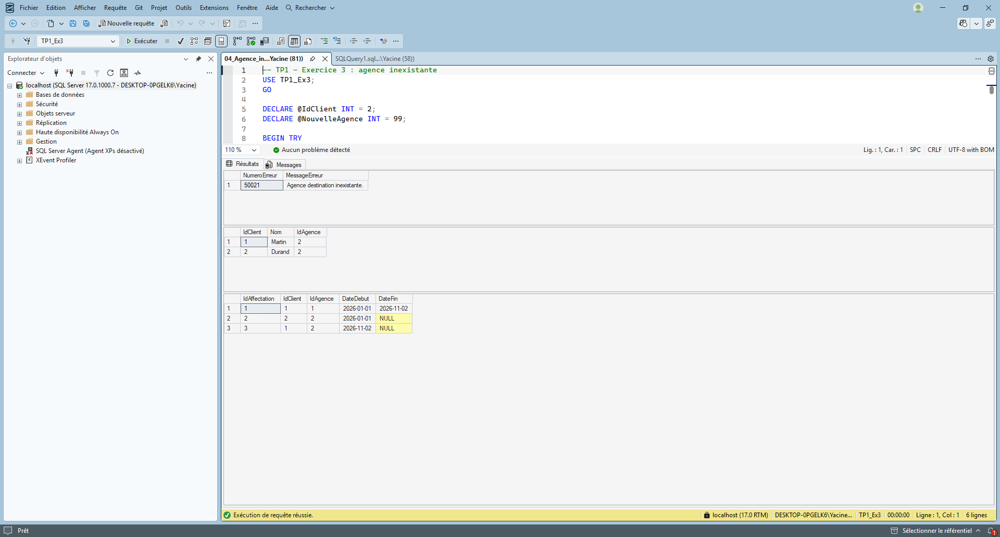

**05_Deja_rattache** : Durand vers son agence actuelle


**06_Erreur_volontaire** : Erreur levée après l'écriture dans l'historique

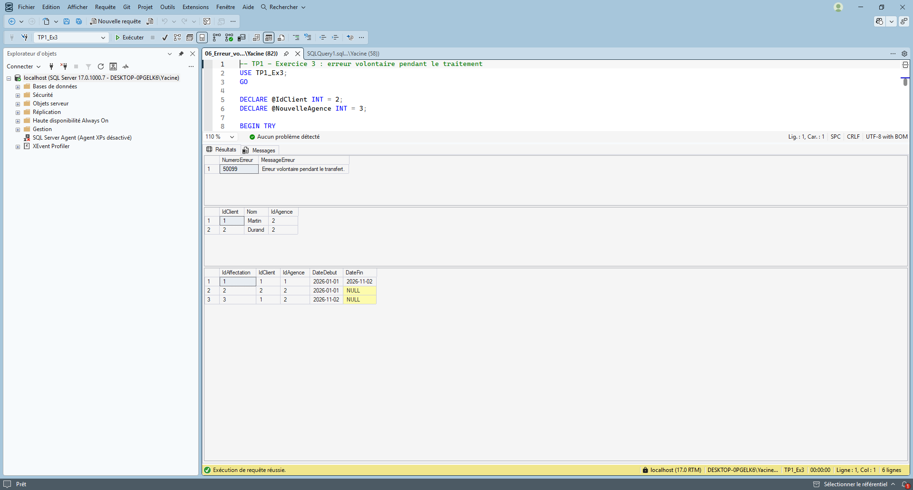

</details>

**Pourquoi l'ordre des opérations compte.** Les contrôles passent avant toute modification. Ensuite, l'ancienne affectation doit être clôturée **avant** d'insérer la nouvelle : l'`UPDATE` cible les lignes `DateFin IS NULL`, et clôturerait aussi la nouvelle affectation si elle existait déjà.

### Exercice 4 : Clôture d'une journée de billetterie

| Script | Ce qui est testé | Résultat obtenu |
| --- | --- | --- |
| [`01_Creation.sql`](SQL/TP1/Ex4_Cloture_billetterie/01_Creation.sql) | Base, tables et données | 8 commandes sur 3 journées |
| [`02_Journee_sans_anomalie.sql`](SQL/TP1/Ex4_Cloture_billetterie/02_Journee_sans_anomalie.sql) | 16/09, 3 commandes | `CLOTUREE`, 190,00 € au journal |
| [`03_Commande_en_anomalie.sql`](SQL/TP1/Ex4_Cloture_billetterie/03_Commande_en_anomalie.sql) | 15/09, commande 102 payée 100 € sur 120 € | Erreur 50030, aucune commande clôturée |
| [`04_Erreur_volontaire.sql`](SQL/TP1/Ex4_Cloture_billetterie/04_Erreur_volontaire.sql) | 17/09, erreur levée après le passage à `CLOTUREE` | Erreur 50099, commandes toujours `EN_ATTENTE`, journal inchangé |

<details>
<summary>Voir les captures</summary>

**01_Creation** : Base, tables et données

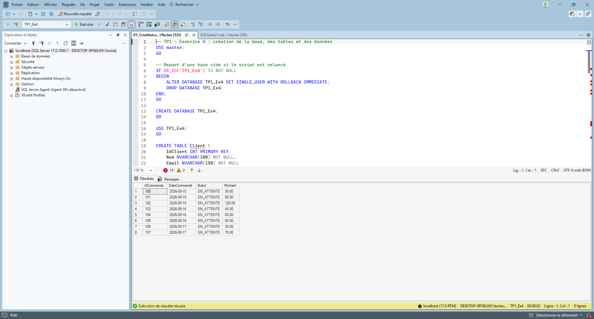

**02_Journee_sans_anomalie** : 16/09, 3 commandes

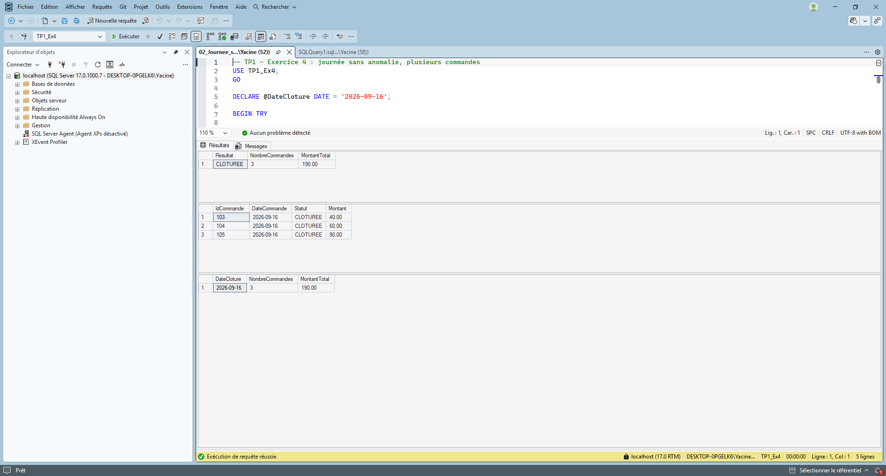

**03_Commande_en_anomalie** : 15/09, commande 102 payée 100 € sur 120 €

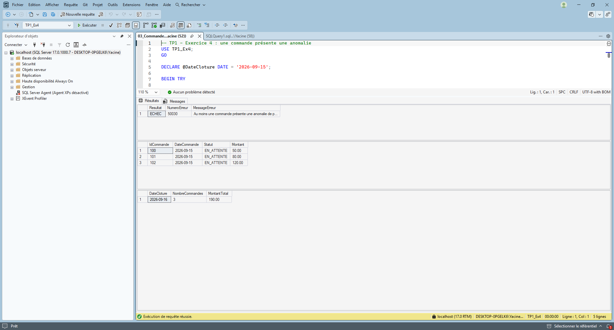

**04_Erreur_volontaire** : 17/09, erreur levée après le passage à `CLOTUREE`


</details>

**Une erreur sur une commande doit-elle annuler toute la clôture ?** Le choix retenu est oui : le journal doit refléter une journée exacte, et l'anomalie doit être traitée avant de clôturer. Une autre stratégie consisterait à isoler la commande anormale et à clôturer les autres, mais il faudrait alors une règle métier pour la traiter ensuite.

**Limite relevée dans le corrigé.** Le contrôle utilise un `INNER JOIN` : une commande **sans aucun paiement** n'apparaît pas dans la requête et passe donc le contrôle. Vérifié avec une commande de test : elle n'est pas détectée, alors qu'elle l'est avec un `LEFT JOIN` et un `COALESCE`. Le script conserve le code du corrigé.

### Exercice 5 : Analyse et correction d'un traitement

Le développeur affirme qu'une transaction est inutile puisque SQL Server signale les erreurs. Pour le vérifier, une contrainte temporaire fait échouer l'`INSERT` du mouvement de stock.

| Script | Ce qui est testé | Résultat obtenu |
| --- | --- | --- |
| [`01_Creation.sql`](SQL/TP1/Ex5_Analyse_correction/01_Creation.sql) | Base, tables et données | Stock de 10, aucun mouvement |
| [`02_Original_avec_erreur.sql`](SQL/TP1/Ex5_Analyse_correction/02_Original_avec_erreur.sql) | Traitement original avec la panne | Commande `VALIDEE`, stock à 8, **aucun mouvement**, et « Commande validée » s'affiche malgré l'erreur |
| [`03_Correction_avec_erreur.sql`](SQL/TP1/Ex5_Analyse_correction/03_Correction_avec_erreur.sql) | Version corrigée, même panne | Erreur 547, commande 101 en `BROUILLON`, stock toujours à 8 |
| [`04_Correction_sans_erreur.sql`](SQL/TP1/Ex5_Analyse_correction/04_Correction_sans_erreur.sql) | Version corrigée, sans panne | `VALIDEE`, stock à 6, 1 mouvement |

<details>
<summary>Voir les captures</summary>

**01_Creation** : Base, tables et données

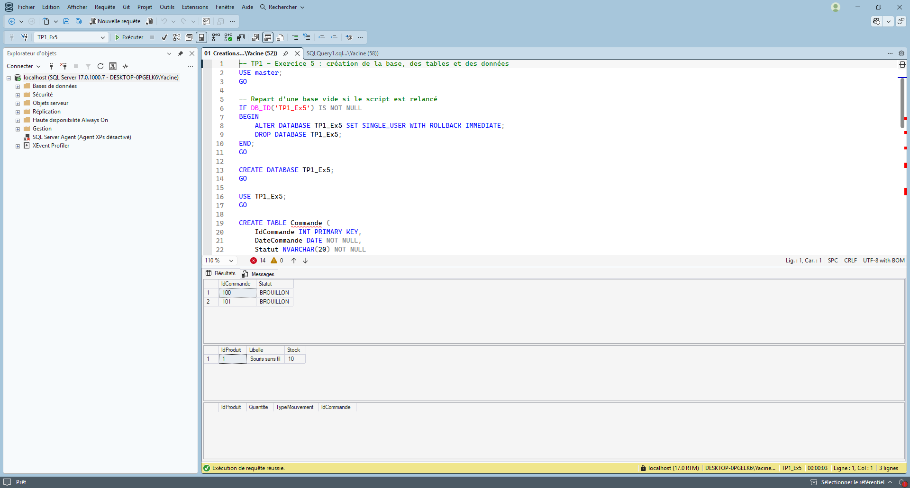

**02_Original_avec_erreur** : Traitement original avec la panne

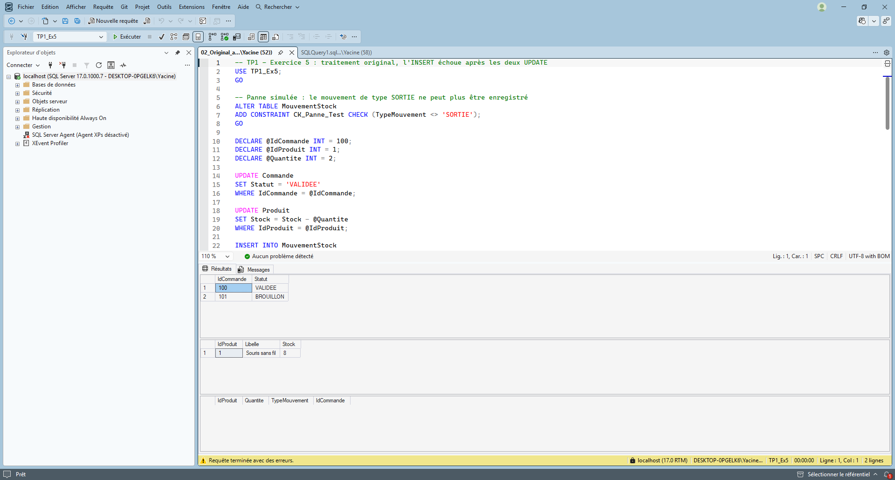

**02_Original_avec_erreur**, onglet Messages

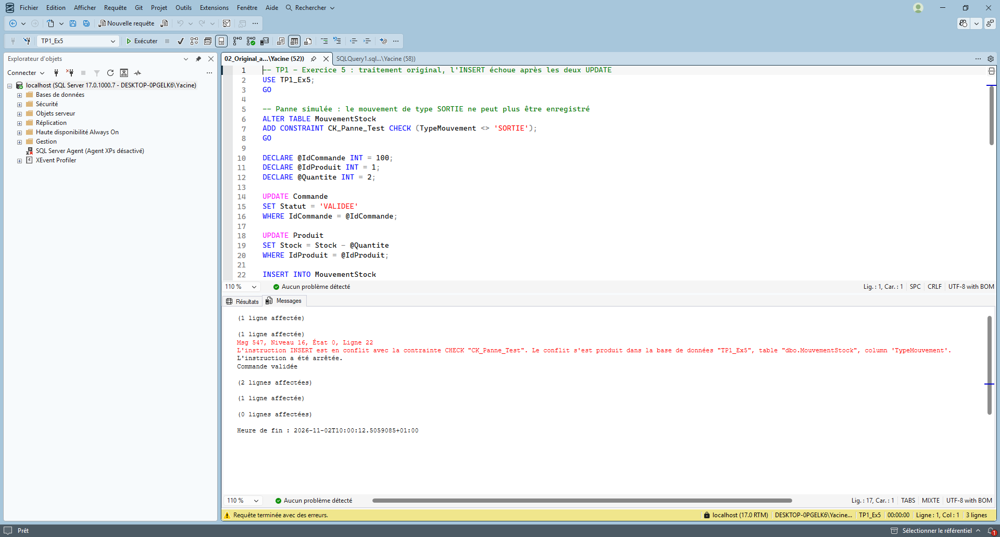

**03_Correction_avec_erreur** : Version corrigée, même panne

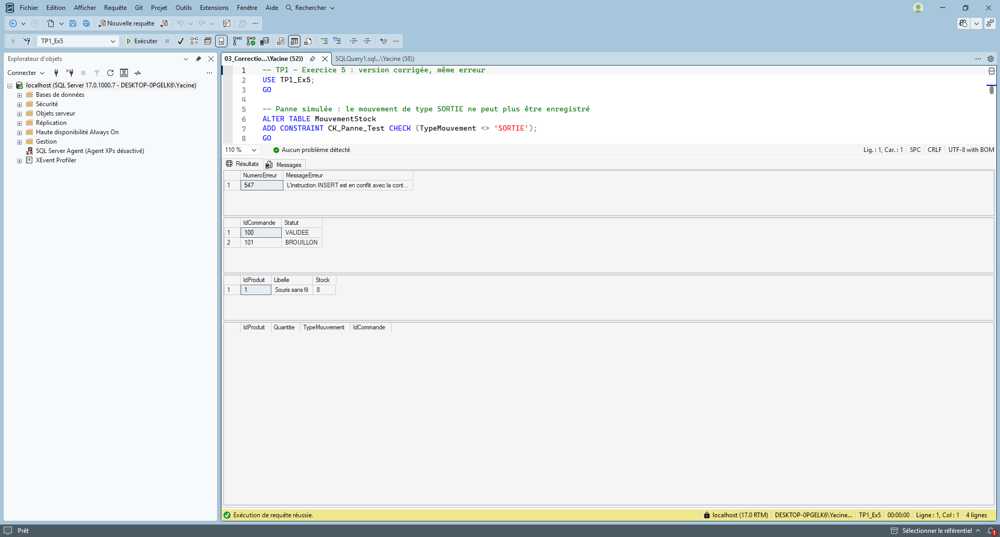

**04_Correction_sans_erreur** : Version corrigée, sans panne

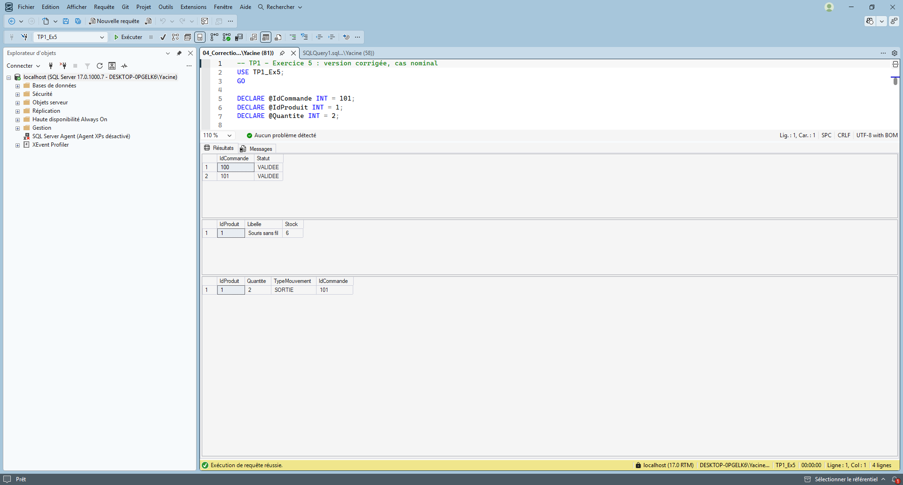

</details>

**Pourquoi « une erreur SQL » ne signifie pas « aucune modification ».** Sans transaction, chaque instruction est validée dès qu'elle réussit. Quand la troisième échoue, les deux premières restent en base, et l'exécution continue jusqu'au `PRINT`. L'erreur est bien signalée, mais la base est déjà incohérente.

### Bilan

1. **Quand une transaction est-elle importante ?** Lorsqu'une opération métier comporte plusieurs modifications qui forment une seule unité de travail.
2. **`COMMIT`, `ROLLBACK`, `TRY...CATCH`.** `COMMIT` valide définitivement les modifications, `ROLLBACK` les annule, et `TRY...CATCH` détecte les erreurs pour décider de l'annulation. Leurs rôles sont complémentaires.
3. **Pourquoi une transaction doit-elle être courte ?** Une transaction longue garde des ressources plus longtemps, provoque davantage d'attentes, augmente les risques de blocage et dégrade les performances.
4. **Une transaction règle-t-elle tous les problèmes d'accès simultanés ?** Non. Elle garantit l'atomicité, mais plusieurs transactions peuvent s'exécuter en même temps.
5. **Exemple d'opération transactionnelle.** Un virement entre deux comptes : un `UPDATE` débite le premier, un `UPDATE` crédite le second et un `INSERT` trace l'opération. Exécutées en partie, ces opérations feraient disparaître de l'argent.

---

## TP2 : Procédures stockées

Base d'un atelier de réparation de matériel informatique.

| Script | Ce qui est testé | Résultat obtenu |
| --- | --- | --- |
| [`01_Creation_tables.sql`](SQL/TP2/01_Creation_tables.sql) | Base et tables | 6 tables créées |
| [`02_Insertion_donnees.sql`](SQL/TP2/02_Insertion_donnees.sql) | Données de test | 6 réparations dans différents statuts |

<details>
<summary>Voir les captures</summary>

**01_Creation_tables** : Base et tables

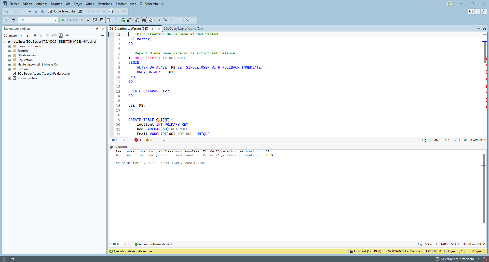

**02_Insertion_donnees** : Données de test

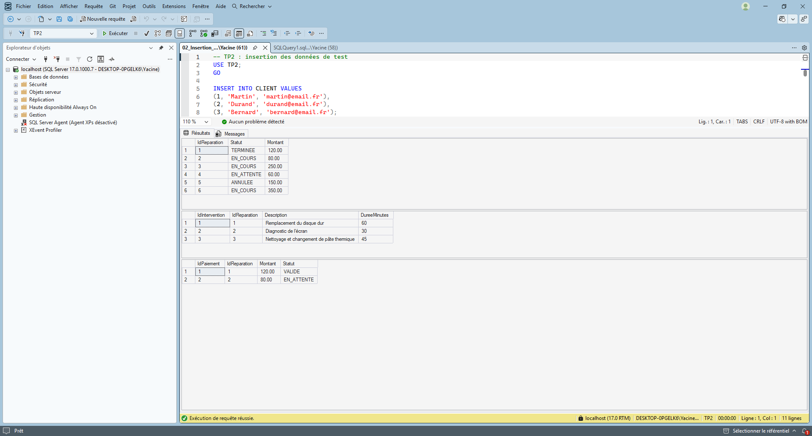

</details>

### Exercice 1 : Consulter les réparations

| Script | Ce qui est testé | Résultat obtenu |
| --- | --- | --- |
| [`01_Procedure.sql`](SQL/TP2/Ex1_Lister_reparations/01_Procedure.sql) | Procédure `ListerReparationsTechnicien` | Procédure créée |
| [`02_Tests.sql`](SQL/TP2/Ex1_Lister_reparations/02_Tests.sql) | Plusieurs réparations, aucune réparation, technicien inexistant | 3 lignes de la plus récente à la plus ancienne, liste vide, erreur 50100 |

<details>
<summary>Voir les captures</summary>

**01_Procedure** : Procédure `ListerReparationsTechnicien`


**02_Tests** : Plusieurs réparations, aucune réparation, technicien inexistant

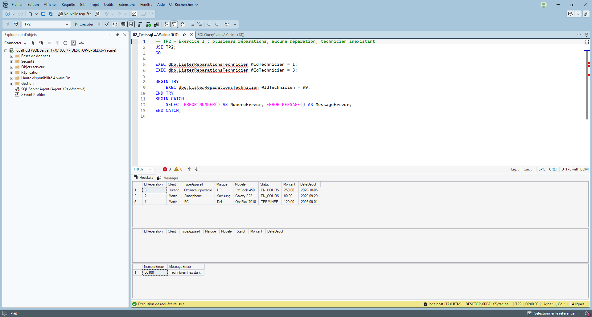

</details>

### Exercice 2 : Rechercher des réparations

Chaque critère vaut `NULL` par défaut : le filtre correspondant ne s'applique alors pas, et une seule requête couvre toutes les combinaisons.

| Script | Ce qui est testé | Résultat obtenu |
| --- | --- | --- |
| [`01_Procedure.sql`](SQL/TP2/Ex2_Rechercher_reparations/01_Procedure.sql) | Procédure `RechercherReparations` | Procédure créée |
| [`02_Tests.sql`](SQL/TP2/Ex2_Rechercher_reparations/02_Tests.sql) | Statut, montant maximal, date minimale, puis les trois ensemble | 1, 4, 3 et 1 lignes |

<details>
<summary>Voir les captures</summary>

**01_Procedure** : Procédure `RechercherReparations`


**02_Tests** : Statut, montant maximal, date minimale, puis les trois ensemble

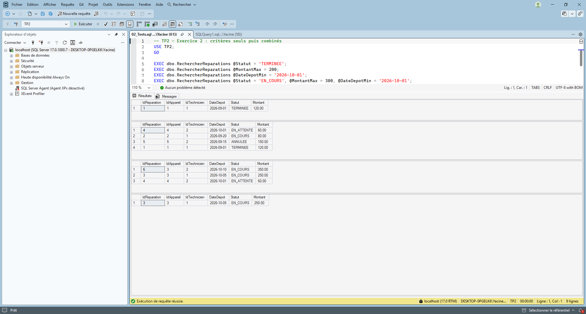

</details>

### Exercice 3 : Ajouter une intervention

La procédure ne fait qu'une seule modification, un `INSERT` : une transaction explicite n'apporterait rien. L'identifiant créé est renvoyé par un paramètre `OUTPUT`.

| Script | Ce qui est testé | Résultat obtenu |
| --- | --- | --- |
| [`01_Procedure.sql`](SQL/TP2/Ex3_Ajouter_intervention/01_Procedure.sql) | Procédure `AjouterIntervention` | Procédure créée |
| [`02_Intervention_valide.sql`](SQL/TP2/Ex3_Ajouter_intervention/02_Intervention_valide.sql) | Réparation en cours | Intervention 4 créée et renvoyée par `OUTPUT` |
| [`03_Reparation_inexistante.sql`](SQL/TP2/Ex3_Ajouter_intervention/03_Reparation_inexistante.sql) | Réparation 999 | Erreur 50110, rien n'est ajouté |
| [`04_Reparation_terminee.sql`](SQL/TP2/Ex3_Ajouter_intervention/04_Reparation_terminee.sql) | Réparation terminée | Erreur 50111, rien n'est ajouté |
| [`05_Reparation_annulee.sql`](SQL/TP2/Ex3_Ajouter_intervention/05_Reparation_annulee.sql) | Réparation annulée | Erreur 50111, rien n'est ajouté |
| [`06_Erreur_enregistrement.sql`](SQL/TP2/Ex3_Ajouter_intervention/06_Erreur_enregistrement.sql) | Description `NULL` | Erreur 515, rien n'est ajouté |

<details>
<summary>Voir les captures</summary>

**01_Procedure** : Procédure `AjouterIntervention`


**02_Intervention_valide** : Réparation en cours

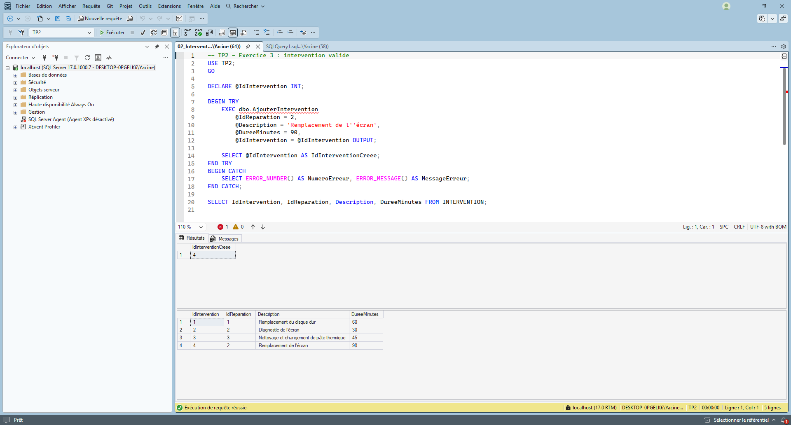

**03_Reparation_inexistante** : Réparation 999

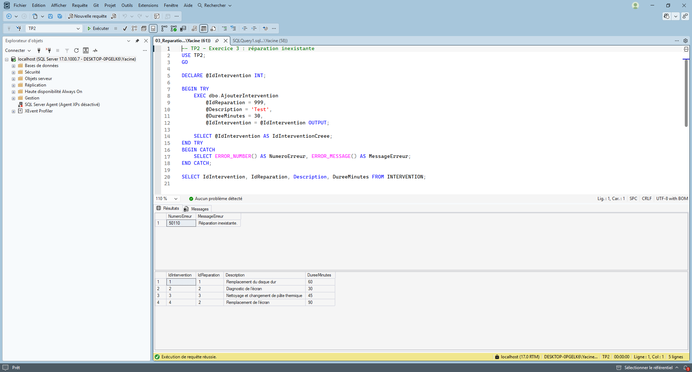

**04_Reparation_terminee** : Réparation terminée


**05_Reparation_annulee** : Réparation annulée


**06_Erreur_enregistrement** : Description `NULL`


</details>

### Exercice 4 : Clôturer une réparation

Le changement de statut et le paiement forment une seule opération métier : ils sont dans la même transaction. Un paiement `EN_ATTENTE` est créé seulement si la réparation n'en a pas déjà un qui n'a pas été refusé.

| Script | Ce qui est testé | Résultat obtenu |
| --- | --- | --- |
| [`01_Procedure.sql`](SQL/TP2/Ex4_Cloturer_reparation/01_Procedure.sql) | Procédure `CloturerReparation` | Procédure créée |
| [`02_Cloture_normale.sql`](SQL/TP2/Ex4_Cloturer_reparation/02_Cloture_normale.sql) | Réparation 3 | `TERMINEE`, paiement de 250,00 € créé, montant renvoyé par `OUTPUT` |
| [`03_Reparation_inexistante.sql`](SQL/TP2/Ex4_Cloturer_reparation/03_Reparation_inexistante.sql) | Réparation 999 | Erreur 50120, rien ne change |
| [`04_Deja_terminee.sql`](SQL/TP2/Ex4_Cloturer_reparation/04_Deja_terminee.sql) | Réparation 1 | Erreur 50121, rien ne change |
| [`05_Reparation_annulee.sql`](SQL/TP2/Ex4_Cloturer_reparation/05_Reparation_annulee.sql) | Réparation 5 | Erreur 50122, rien ne change |
| [`06_Erreur_volontaire.sql`](SQL/TP2/Ex4_Cloturer_reparation/06_Erreur_volontaire.sql) | Le paiement échoue après la modification du statut | Erreur 547, réparation 6 toujours `EN_COURS`, aucun paiement |

<details>
<summary>Voir les captures</summary>

**01_Procedure** : Procédure `CloturerReparation`


**02_Cloture_normale** : Réparation 3

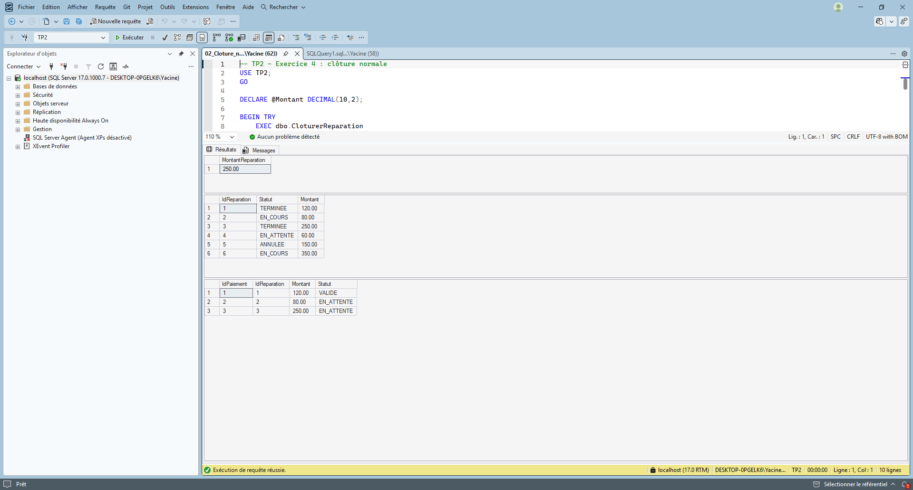

**03_Reparation_inexistante** : Réparation 999


**04_Deja_terminee** : Réparation 1


**05_Reparation_annulee** : Réparation 5

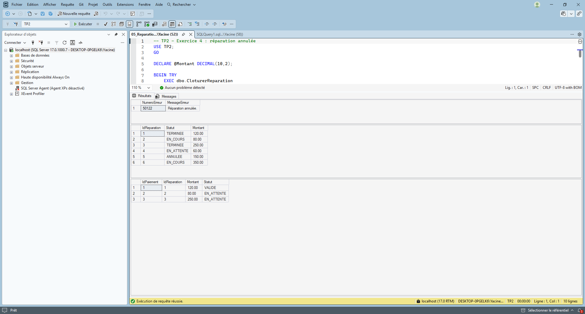

**06_Erreur_volontaire** : Le paiement échoue après la modification du statut

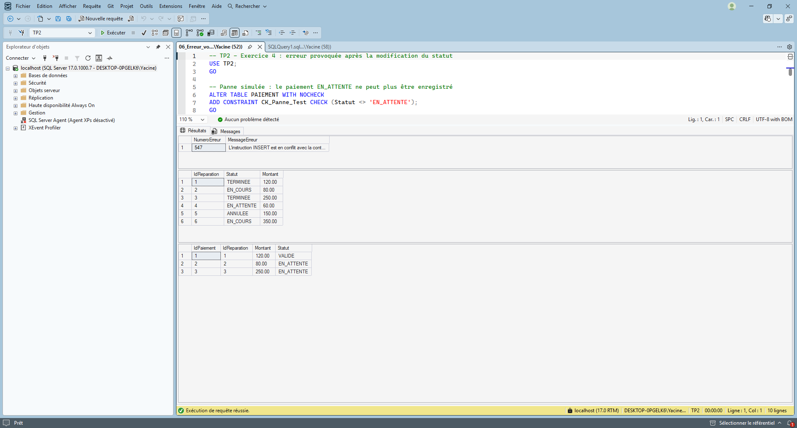

</details>

### Exercice 5 : Analyser une procédure existante

**Problèmes de la procédure d'origine :**

- aucune transaction : le statut reste modifié si le paiement échoue ;
- aucun contrôle d'existence : une réparation inexistante ne modifie rien, mais « Réparation terminée » s'affiche quand même ;
- aucun contrôle du statut : une réparation annulée peut être terminée, et un second appel crée un second paiement ;
- le `PRINT` s'exécute même après une erreur.

**Si la seconde opération échoue**, la réparation est `TERMINEE` sans paiement : le test `01` le montre sur la réparation 4. La correction ajoute les contrôles, regroupe les deux modifications dans une transaction et n'affiche le message qu'après le `COMMIT`.

| Script | Ce qui est testé | Résultat obtenu |
| --- | --- | --- |
| [`01_Procedure_originale.sql`](SQL/TP2/Ex5_Analyser_procedure/01_Procedure_originale.sql) | Procédure d'origine avec un paiement qui échoue | Réparation 4 `TERMINEE`, aucun paiement, et « Réparation terminée » s'affiche |
| [`02_Procedure_corrigee.sql`](SQL/TP2/Ex5_Analyser_procedure/02_Procedure_corrigee.sql) | Procédure corrigée | Procédure modifiée |
| [`03_Test_erreur.sql`](SQL/TP2/Ex5_Analyser_procedure/03_Test_erreur.sql) | Même panne sur la réparation 6 | Erreur 547, réparation toujours `EN_COURS` |
| [`04_Test_nominal.sql`](SQL/TP2/Ex5_Analyser_procedure/04_Test_nominal.sql) | Deux appels à la suite sur la réparation 6 | `TERMINEE` et paiement de 350,00 €, puis second appel refusé (erreur 50131) |

<details>
<summary>Voir les captures</summary>

**01_Procedure_originale** : Procédure d'origine avec un paiement qui échoue

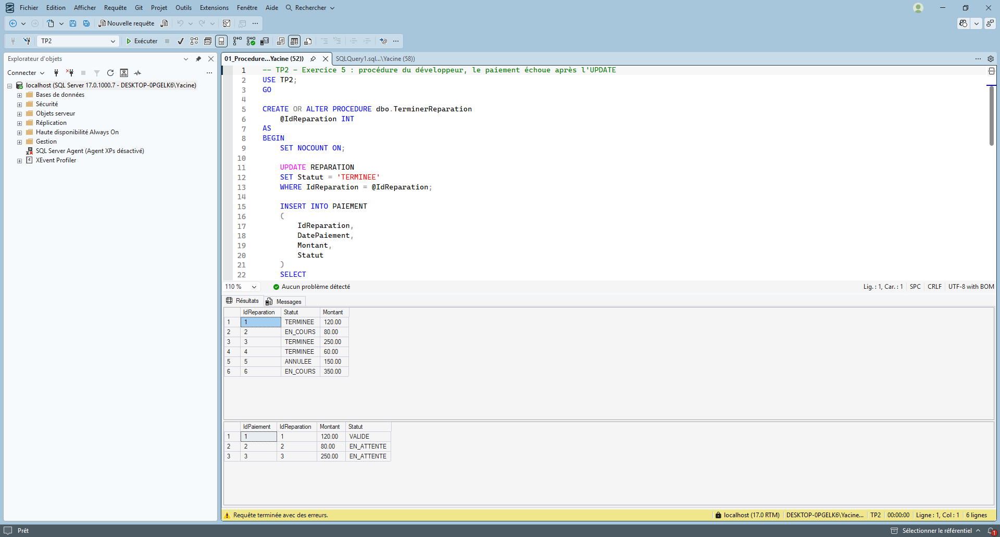

**01_Procedure_originale**, onglet Messages

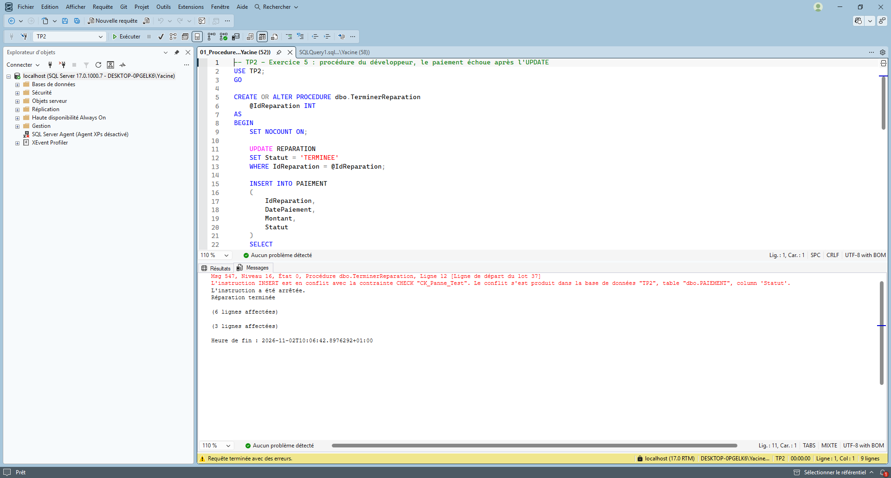

**02_Procedure_corrigee** : Procédure corrigée

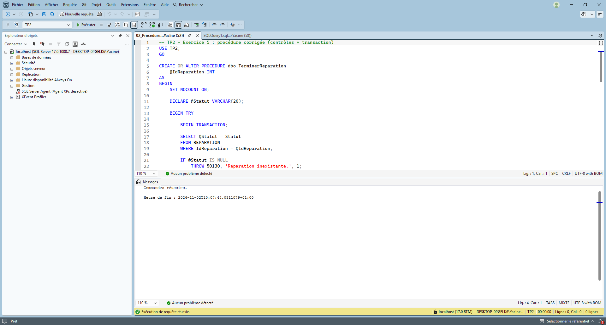

**03_Test_erreur** : Même panne sur la réparation 6

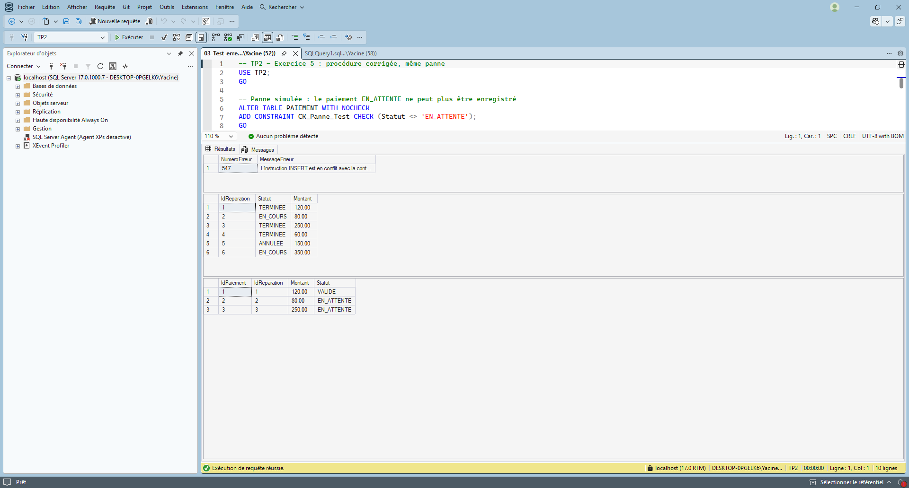

**04_Test_nominal** : Deux appels à la suite sur la réparation 6

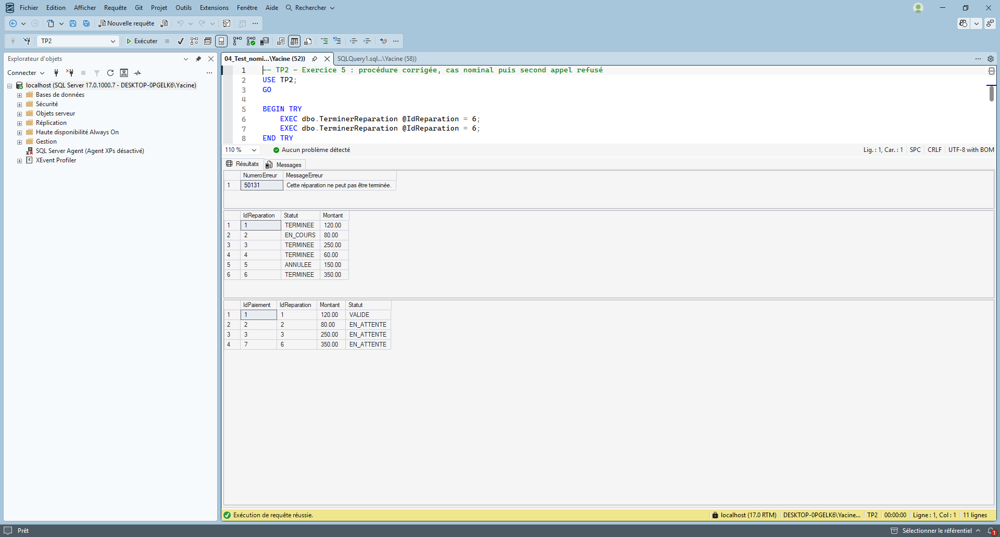

</details>

> Dans le test `04`, le paiement porte l'identifiant 7 et non 4 : un `ROLLBACK` annule les lignes, mais pas les valeurs `IDENTITY` déjà consommées par les insertions qui ont échoué.

---

## TP3 : Fonctions, curseurs et triggers

Base d'une plateforme de location de véhicules.

| Script | Ce qui est testé | Résultat obtenu |
| --- | --- | --- |
| [`01_Creation.sql`](SQL/TP3/01_Creation.sql) | Base, tables et données | 6 véhicules, 5 locations |

<details>
<summary>Voir les captures</summary>

**01_Creation** : Base, tables et données

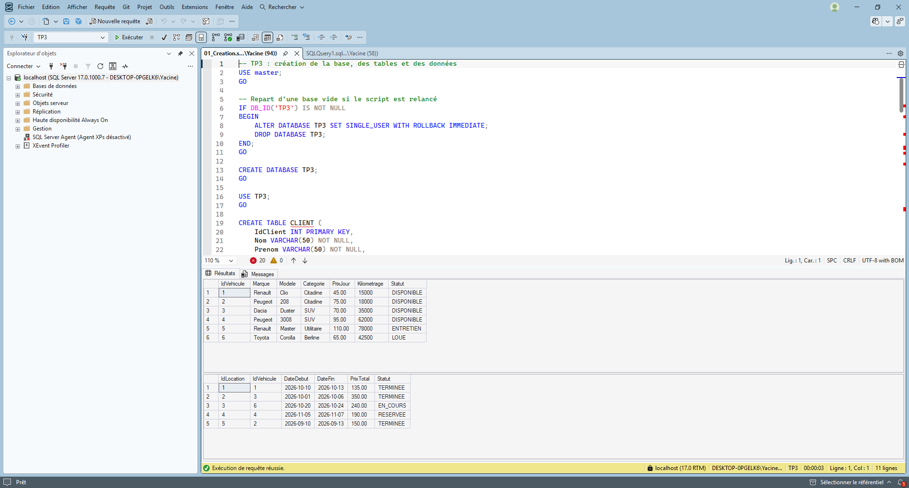

</details>

### Exercice 1 : Calcul du prix d'une location

| Script | Ce qui est testé | Résultat obtenu |
| --- | --- | --- |
| [`01_Fonction.sql`](SQL/TP3/Ex1_Prix_location/01_Fonction.sql) | Fonction scalaire `fn_CalculPrixLocation`, plusieurs durées | 150, 50, 50 et 1 500 € pour un tarif de 50 €/jour |
| [`02_Comparaison_prix.sql`](SQL/TP3/Ex1_Prix_location/02_Comparaison_prix.sql) | Prix calculé et prix enregistré pour chaque location | Écart sur 2 locations sur 5 |

<details>
<summary>Voir les captures</summary>

**01_Fonction** : Fonction scalaire `fn_CalculPrixLocation`, plusieurs durées


**02_Comparaison_prix** : Prix calculé et prix enregistré pour chaque location

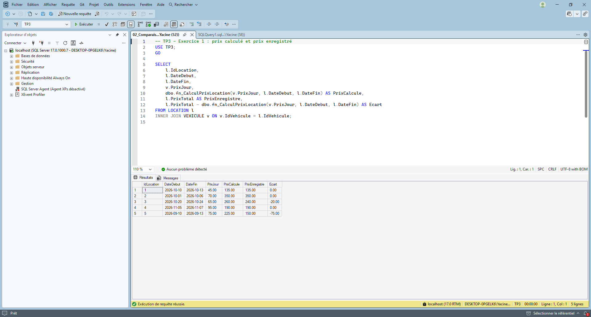

</details>

**Analyse.** Deux locations sont incohérentes : la **n°3** (260 € calculés, 240 € enregistrés, soit -20 €) et la **n°5** (225 € calculés, 150 € enregistrés, soit -75 €). Ces écarts peuvent venir d'une erreur de facturation ou d'une remise non tracée : la colonne `Ecart` permet de les repérer. Un véhicule rendu le jour même est facturé une journée.

### Exercice 2 : Rechercher les véhicules

| Script | Ce qui est testé | Résultat obtenu |
| --- | --- | --- |
| [`01_Fonction_et_recherches.sql`](SQL/TP3/Ex2_Recherche_vehicules/01_Fonction_et_recherches.sql) | Fonction table `fn_RechercherVehicules` et 4 recherches | 4 disponibles, 2 SUV, 3 à moins de 80 €, 2 citadines à moins de 80 € |
| [`02_Exploitation.sql`](SQL/TP3/Ex2_Recherche_vehicules/02_Exploitation.sql) | Utilisation dans une requête | Véhicule, catégorie, prix et kilométrage, triés par prix |

<details>
<summary>Voir les captures</summary>

**01_Fonction_et_recherches** : Fonction table `fn_RechercherVehicules` et 4 recherches


**02_Exploitation** : Utilisation dans une requête

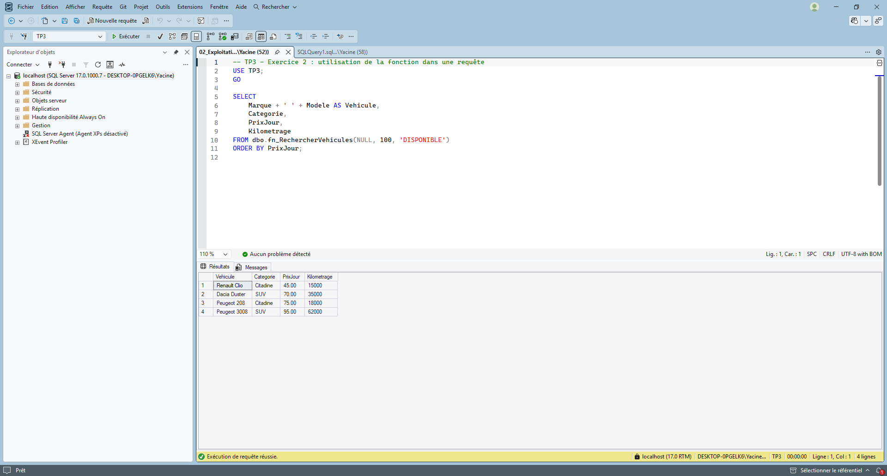

</details>

**Pourquoi une fonction retournant une table ?** Son résultat s'utilise comme une table dans le `FROM` : on peut le filtrer, le trier ou le joindre à d'autres tables, ce qu'une procédure stockée ne permet pas.

### Exercice 3 : Contrôle de la flotte

| Script | Ce qui est testé | Résultat obtenu |
| --- | --- | --- |
| [`01_Curseur.sql`](SQL/TP3/Ex3_Controle_flotte/01_Curseur.sql) | Curseur parcourant les véhicules | Niveau affiché pour chacun des 6 véhicules |
| [`02_Sans_curseur.sql`](SQL/TP3/Ex3_Controle_flotte/02_Sans_curseur.sql) | Même classement avec un `CASE` | Résultat identique |

<details>
<summary>Voir les captures</summary>

**01_Curseur** : Curseur parcourant les véhicules

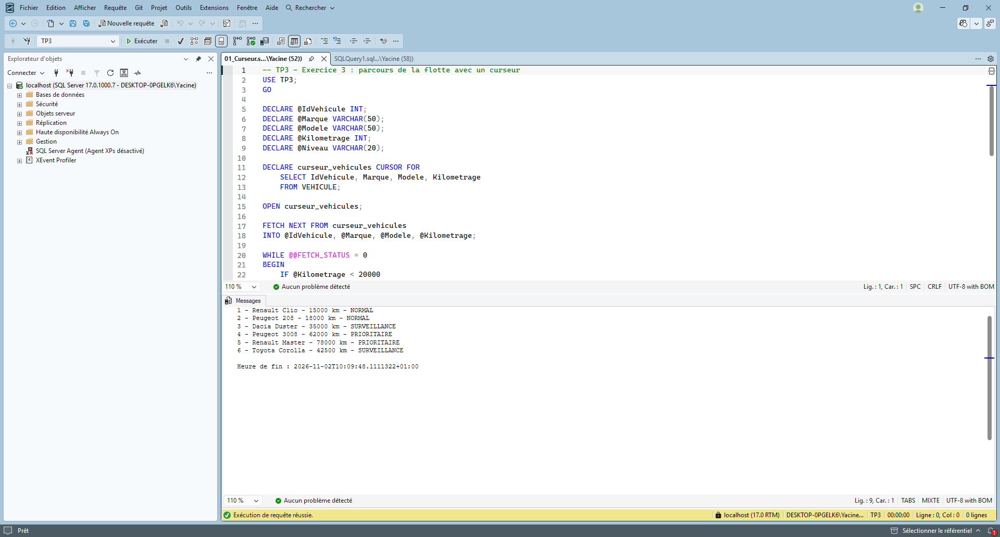

**02_Sans_curseur** : Même classement avec un `CASE`


</details>

**Analyse.** Oui, ce traitement peut se faire sans curseur : le niveau ne dépend que du véhicule lui-même, et le script `02` donne le même résultat avec une seule requête. Le curseur reste utile si le traitement de chaque véhicule doit dépendre du précédent.

### Exercice 4 : Historiser les changements

Le trigger joint `deleted` et `inserted` : il gère donc plusieurs lignes, et n'enregistre que celles dont le statut ou le kilométrage a réellement changé.

| Script | Ce qui est testé | Résultat obtenu |
| --- | --- | --- |
| [`01_Table_et_trigger.sql`](SQL/TP3/Ex4_Historique/01_Table_et_trigger.sql) | Table `HISTORIQUE_VEHICULE` et trigger | Table et trigger créés |
| [`02_Cas1_Statut.sql`](SQL/TP3/Ex4_Historique/02_Cas1_Statut.sql) | Changement de statut | 1 ligne, `DISPONIBLE` vers `LOUE` |
| [`03_Cas2_Kilometrage.sql`](SQL/TP3/Ex4_Historique/03_Cas2_Kilometrage.sql) | Changement de kilométrage | 1 ligne de plus, 18 000 vers 18 500 km |
| [`04_Cas3_Statut_et_kilometrage.sql`](SQL/TP3/Ex4_Historique/04_Cas3_Statut_et_kilometrage.sql) | Les deux en même temps | 1 ligne de plus avec les deux changements |
| [`05_Cas4_Plusieurs_vehicules.sql`](SQL/TP3/Ex4_Historique/05_Cas4_Plusieurs_vehicules.sql) | 3 véhicules dans un seul `UPDATE` | 3 lignes de plus |

<details>
<summary>Voir les captures</summary>

**01_Table_et_trigger** : Table `HISTORIQUE_VEHICULE` et trigger


**02_Cas1_Statut** : Changement de statut


**03_Cas2_Kilometrage** : Changement de kilométrage

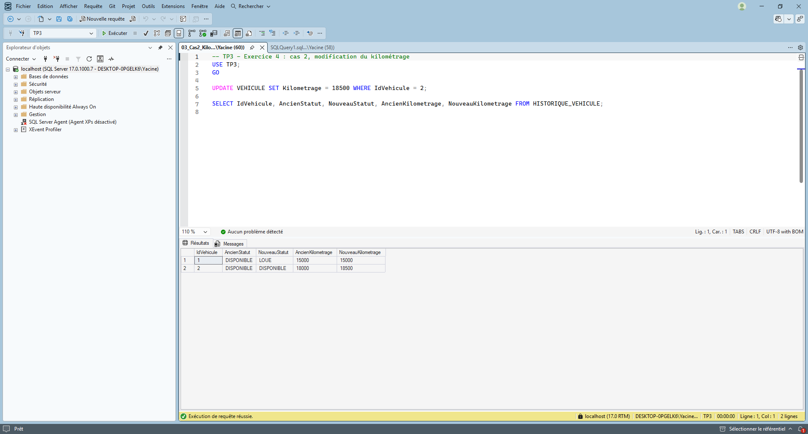

**04_Cas3_Statut_et_kilometrage** : Les deux en même temps

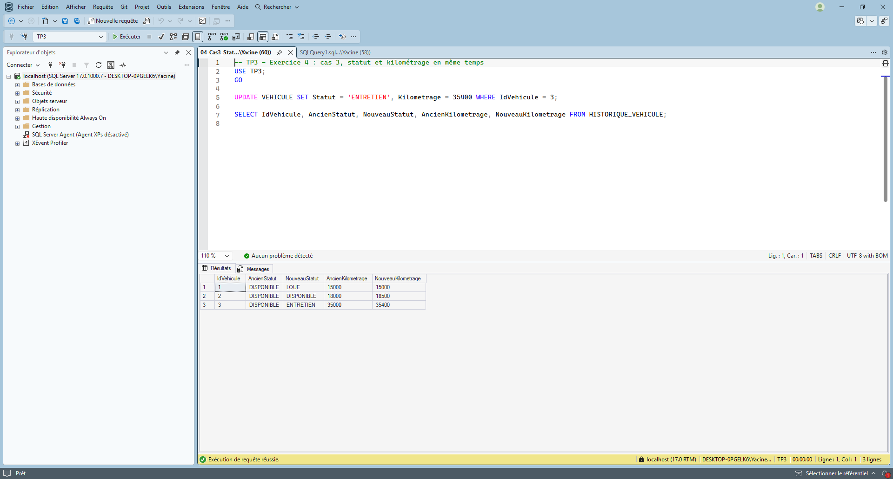

**05_Cas4_Plusieurs_vehicules** : 3 véhicules dans un seul `UPDATE`


</details>

### Exercice 5 : Sécuriser le kilométrage

| Script | Ce qui est testé | Résultat obtenu |
| --- | --- | --- |
| [`01_Trigger.sql`](SQL/TP3/Ex5_Securiser_kilometrage/01_Trigger.sql) | Trigger `trg_Vehicule_KilometrageCroissant` | Trigger créé |
| [`02_Augmentation.sql`](SQL/TP3/Ex5_Securiser_kilometrage/02_Augmentation.sql) | 42 600 vers 44 000 km | Accepté |
| [`03_Diminution.sql`](SQL/TP3/Ex5_Securiser_kilometrage/03_Diminution.sql) | 44 000 vers 42 000 km | Erreur 50200, le kilométrage reste à 44 000 |
| [`04_Sans_changement.sql`](SQL/TP3/Ex5_Securiser_kilometrage/04_Sans_changement.sql) | Changement de statut seul | Accepté |
| [`05_Plusieurs_vehicules.sql`](SQL/TP3/Ex5_Securiser_kilometrage/05_Plusieurs_vehicules.sql) | +200 km sur 2 véhicules | Accepté |

<details>
<summary>Voir les captures</summary>

**01_Trigger** : Trigger `trg_Vehicule_KilometrageCroissant`


**02_Augmentation** : 42 600 vers 44 000 km


**03_Diminution** : 44 000 vers 42 000 km

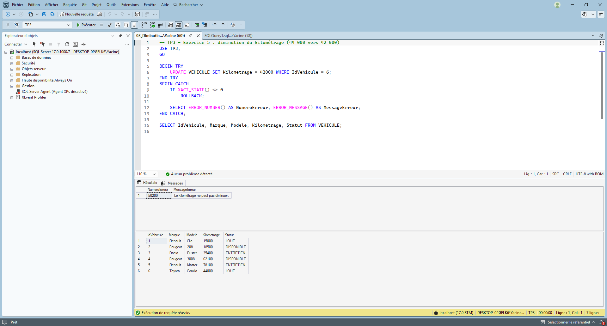

**04_Sans_changement** : Changement de statut seul

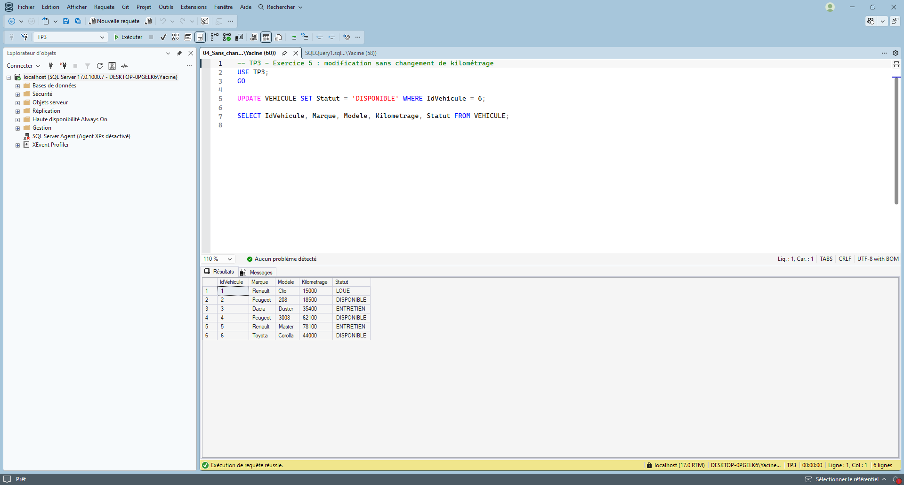

**05_Plusieurs_vehicules** : +200 km sur 2 véhicules

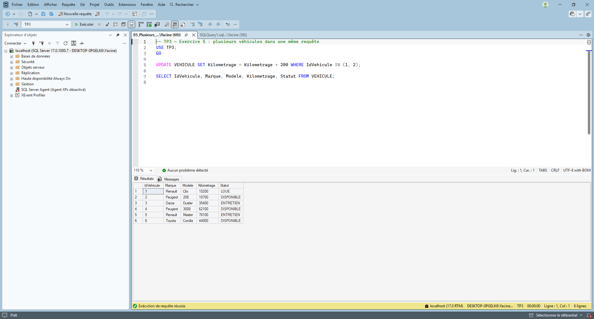

</details>

### Exercice 6 : Analyse d'un trigger existant

**Analyse.** Un trigger s'exécute une seule fois par instruction, quel que soit le nombre de lignes modifiées. Les variables du développeur ne gardent qu'une seule ligne, la dernière lue, et l'ordre de lecture n'est pas garanti. Le trigger fonctionne donc sur une ligne, mais peut laisser passer une anomalie sur plusieurs : dans le test `02`, le kilométrage du véhicule 2 passe à 1 000 km sans aucune erreur.

**Correction.** Le trigger joint `deleted` et `inserted`, et échoue dès qu'**au moins une** ligne présente une diminution. Le trigger de l'exercice 5 est désactivé pendant cet exercice, pour observer celui-ci seul.

| Script | Ce qui est testé | Résultat obtenu |
| --- | --- | --- |
| [`01_Trigger_junior_une_ligne.sql`](SQL/TP3/Ex6_Analyse_trigger/01_Trigger_junior_une_ligne.sql) | Trigger du junior, une seule ligne | Erreur 50001, l'anomalie est détectée |
| [`02_Trigger_junior_plusieurs_lignes.sql`](SQL/TP3/Ex6_Analyse_trigger/02_Trigger_junior_plusieurs_lignes.sql) | Trigger du junior, anomalie sur le véhicule 2 | « Aucune erreur levée », kilométrage à 1 000 km (annulé ensuite par un `ROLLBACK`) |
| [`03_Correction.sql`](SQL/TP3/Ex6_Analyse_trigger/03_Correction.sql) | Trigger corrigé | Trigger modifié |
| [`04_Test_une_ligne.sql`](SQL/TP3/Ex6_Analyse_trigger/04_Test_une_ligne.sql) | Correction, une seule ligne | Erreur 50001, rien ne change |
| [`05_Test_plusieurs_lignes.sql`](SQL/TP3/Ex6_Analyse_trigger/05_Test_plusieurs_lignes.sql) | Correction, plusieurs lignes valides | Accepté |
| [`06_Test_une_anomalie.sql`](SQL/TP3/Ex6_Analyse_trigger/06_Test_une_anomalie.sql) | Correction, même anomalie que le test `02` | Erreur 50001, aucune des deux lignes n'est modifiée |

<details>
<summary>Voir les captures</summary>

**01_Trigger_junior_une_ligne** : Trigger du junior, une seule ligne

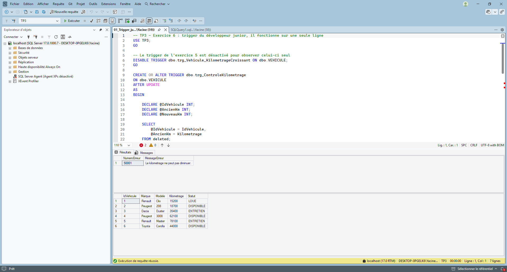

**02_Trigger_junior_plusieurs_lignes** : Trigger du junior, anomalie sur le véhicule 2

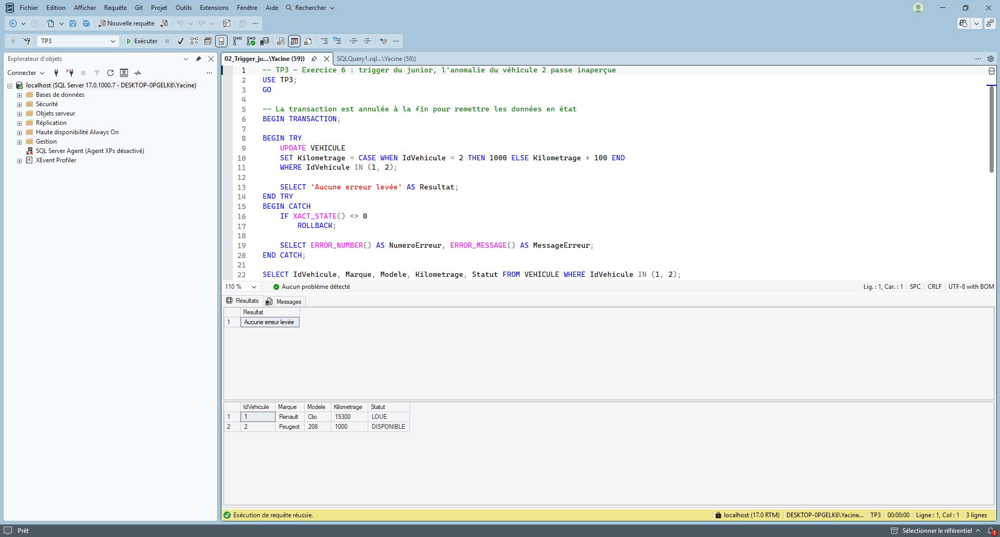

**03_Correction** : Trigger corrigé

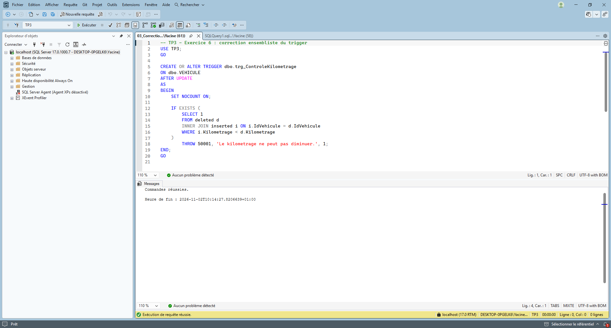

**04_Test_une_ligne** : Correction, une seule ligne

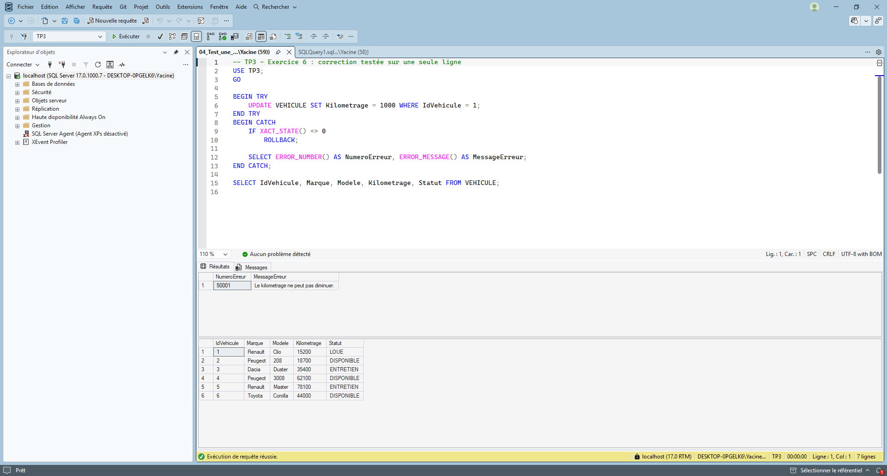

**05_Test_plusieurs_lignes** : Correction, plusieurs lignes valides

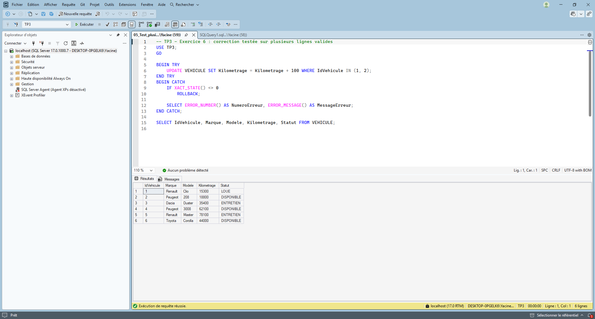

**06_Test_une_anomalie** : Correction, même anomalie que le test `02`


</details>

### Exercice 7 : Choisir le bon mécanisme

| Situation | Mécanisme | Justification |
| --- | --- | --- |
| **A** : calculer le prix d'une location à partir de plusieurs valeurs | Fonction scalaire | Elle retourne une seule valeur, utilisable directement dans un `SELECT` |
| **B** : lister les véhicules disponibles selon plusieurs critères | Fonction retournant une table | Elle retourne des lignes que l'on peut filtrer ou joindre à d'autres tables |
| **C** : enregistrer automatiquement un historique lors d'une modification | Trigger | Il réagit à la modification sans appel explicite |
| **D** : exécuter une opération métier pour clôturer une location | Procédure stockée | Elle est appelée explicitement et peut regrouper plusieurs modifications dans une transaction |
| **E** : parcourir des véhicules dont le traitement dépend du véhicule précédent | Curseur | Le traitement doit se faire ligne par ligne, dans l'ordre |

---

## Arborescence du dépôt

```
03 - Conception d'une base de données/
├── README.md
├── Documents/
│   ├── TP1 - Transaction et gestion des erreurs.pdf
│   ├── TP2 - Les procédures.pdf
│   └── TP3 - Fonctions, curseurs et triggers.pdf
├── SQL/
│   ├── TP1/
│   │   ├── Ex1_Inventaire/
│   │   ├── Ex2_Reservation/
│   │   ├── Ex3_Transfert_client/
│   │   ├── Ex4_Cloture_billetterie/
│   │   └── Ex5_Analyse_correction/
│   ├── TP2/
│   │   ├── 01_Creation_tables.sql
│   │   ├── 02_Insertion_donnees.sql
│   │   └── Ex1 à Ex5/
│   └── TP3/
│       ├── 01_Creation.sql
│       └── Ex1 à Ex6/
└── Images/
    └── (même organisation que SQL/ : une capture par script)
```
