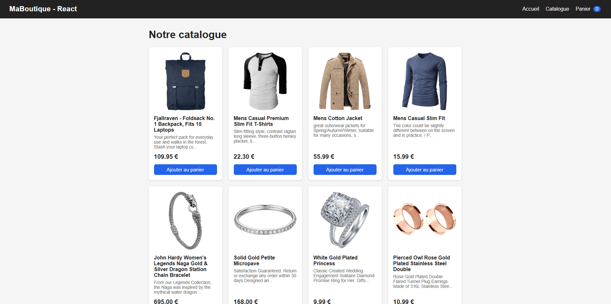

# MaBoutique - React



> Site e-commerce réalisé en **React** et **TypeScript** à partir d'un projet **Vite** : catalogue de produits chargé depuis une **API JSON**, panier avec gestion des quantités et formulaire de commande sécurisé. Projet du cours **Framework JS**.

> Démo disponible : https://yacineharrache.fr/maboutique-react/

---

## Sommaire

- [Introduction](#introduction)
- [Fonctionnalités](#fonctionnalités)
- [Technologies utilisées](#technologies-utilisées)
- [Point de départ : un projet Vite](#point-de-départ--un-projet-vite)
- [Architecture](#architecture)
- [Sécurité du formulaire](#sécurité-du-formulaire)
- [Installation](#installation)
- [Arborescence du dépôt](#arborescence-du-dépôt)
- [Difficultés rencontrées](#difficultés-rencontrées)
- [Perspectives d'évolution](#perspectives-dévolution)
- [Conclusion](#conclusion)

---

## Introduction

Ce projet est un **site e-commerce** réalisé dans le cadre de ma 2ème année, pendant l'atelier pratique « Site e-commerce » du cours **Framework JS**. L'objectif était de découvrir **React** en construisant une application complète : affichage d'un catalogue, gestion d'un panier et passage de commande.

Le site est une **SPA** (*Single Page Application*) : il n'y a qu'une seule page HTML, et React change son contenu selon la navigation, sans jamais recharger la page. Les produits proviennent de la [Fake Store API](https://fakestoreapi.com/products), une API gratuite qui renvoie des produits fictifs au format **JSON**.

L'ensemble du code est **commenté ligne par ligne** pour expliquer le rôle de chaque bloc.

---

## Fonctionnalités

- **Catalogue** : 20 produits chargés depuis l'API, affichés en grille avec image, titre, description et prix
- **Chargement et erreur** : message « Chargement… » pendant l'appel à l'API, et message d'erreur si elle ne répond pas
- **Panier** : ajout d'un produit, boutons + / − pour la quantité, retrait d'une ligne, vidage complet, sous-totaux et total
- **Compteur** : nombre d'articles affiché dans le menu, avec une petite animation à chaque changement
- **Notification** : message animé « Article ajouté au panier ! » à chaque ajout
- **Commande** : formulaire de livraison (nom, e-mail, adresse, code postal, ville) avec vérification de chaque champ
- **Navigation** : menu Accueil / Catalogue / Panier avec React Router, et page « Page introuvable » pour les adresses inconnues
- **Responsive** : affichage adapté au téléphone

---

## Technologies utilisées

| Outil | Rôle |
|---|---|
| **Vite 8** | Création du projet, serveur de développement et construction de la version finale (`npm run build`) |
| **React 19** | Bibliothèque JavaScript pour construire l'interface avec des composants |
| **TypeScript** | JavaScript avec des types : les erreurs sont détectées pendant qu'on code |
| **React Router 7** | Navigation entre les pages sans rechargement |
| **Fake Store API** (JSON) | Fournit la liste des produits, récupérée avec `fetch()` |
| **HTML** + **CSS** | Structure de la page, grille du catalogue, animations et responsive |
| **ESLint** | Correcteur de code |

**Notions React utilisées** : composants, JSX, props, state avec `useState`, appel à l'API avec `useEffect`, événements, affichage conditionnel, listes avec `.map()` et `key`, routes avec React Router.

---

## Point de départ : un projet Vite

Le projet part du modèle **React + TypeScript** proposé par Vite, décrit dans le [guide officiel de Vite](https://vite.dev/guide/). Il a été créé avec :

```bash
npm create vite@latest e-commerce -- --template react-ts
```

Cette commande génère une application de démonstration (un compteur avec les logos de Vite et React). À partir de cette base, j'ai :

1. installé **React Router** avec `npm install react-router-dom` ;
2. remplacé la page de démonstration par mes propres **pages** (`Accueil`, `Produits`, `Panier`, `Commande`) et **composants** (`Header`, `Footer`, `ProductCard`, `Notification`) ;
3. écrit tout le style du site dans `index.css` ;
4. construit l'application finale avec `npm run build`.

Quelques fichiers de la démo ont été gardés et mis en commentaire (`ThemeContext.ts`, `ThemeProvider.tsx`) pour montrer la base de départ. Ils n'ont aucun effet sur le site.

---

## Architecture

Le site démarre ainsi :

```
npm run dev ──► Vite ──► index.html ──► main.tsx ──► App.tsx ──► pages et composants
```

**`App.tsx`** est le composant principal. Il contient le **panier** (state) et les fonctions qui le modifient, puis les transmet aux pages qui en ont besoin :

```
App  (contient le panier et les fonctions qui le modifient)
├── Header           ← reçoit nbArticles
├── Routes           ← affiche UNE page selon l'adresse
│   ├── /            → Accueil
│   ├── /produits    → Produits          ← reçoit onAjouter
│   │                   └── ProductCard (×20)
│   ├── /panier      → Panier            ← reçoit panier, total et les fonctions
│   ├── /commande    → Commande          ← reçoit total, nbArticles, onValider
│   └── *            → Page introuvable
├── Footer
└── Notification     ← s'affiche après un ajout
```

> **Les données descendent par les props. Les actions remontent par les fonctions.**

| Dossier / fichier | Contenu |
|---|---|
| `src/pages/` | Un écran complet par adresse : `Accueil`, `Produits`, `Panier`, `Commande` |
| `src/components/` | Briques d'interface réutilisables : `Header`, `Footer`, `ProductCard`, `Notification` |
| `src/types.ts` | Modèles TypeScript : `Produit` et `PanierItem` |
| `src/App.tsx` | Panier, fonctions d'ajout / retrait, routes |
| `src/index.css` | Tout le style du site |

---

## Sécurité du formulaire

Le formulaire de commande vérifie chaque champ avant de valider, grâce à des **expressions régulières** (regex) :

| Champ | Règle |
|---|---|
| Nom | Lettres (accents compris), espaces, tirets et apostrophes, de 2 à 50 caractères |
| E-mail | Format `texte@texte.extension` |
| Adresse | Lettres, chiffres, espaces et ponctuation simple (`, . - '`), de 5 à 100 caractères |
| Code postal | Exactement 5 chiffres |
| Ville | Lettres (accents compris), espaces, tirets et apostrophes, de 2 à 50 caractères |

- Les espaces en trop sont retirés avec `.trim()` : un champ rempli uniquement d'espaces est considéré comme vide.
- Au premier champ incorrect, un message précis indique quoi corriger.
- `maxLength` limite la longueur de saisie, et le code postal affiche le clavier numérique sur téléphone.
- React échappe automatiquement le texte affiché, ce qui protège contre l'injection de code HTML.

Cette vérification se fait dans le navigateur. Dans un vrai site, le serveur devrait refaire les mêmes contrôles.

---

## Installation

### Prérequis

| Outil | Rôle | Vérification |
|---|---|---|
| [Node.js 20 ou plus](https://nodejs.org/) | Exécute Vite et installe les bibliothèques avec npm | `node -v` |

Une connexion Internet est nécessaire pour charger les produits depuis l'API.

### 1. Récupérer le projet

```bash
git clone https://github.com/yacinehrc/B2.git
```

```bash
cd "B2/04 - MaBoutique - React"
```

### 2. Installer les dépendances

```bash
npm install
```

### 3. Lancer le site

```bash
npm run dev
```

Ouvrir ensuite <http://localhost:5173> dans le navigateur.

### Commandes utiles

| Commande | Rôle |
|---|---|
| `npm run dev` | Lance le site en développement (mise à jour automatique à chaque sauvegarde) |
| `npm run build` | Vérifie le TypeScript puis crée la version finale optimisée dans `dist/` |
| `npm run preview` | Affiche la version de `dist/` pour la tester |
| `npm run lint` | Lance ESLint |

---

## Arborescence du dépôt

```
04 - MaBoutique - React/
├── README.md
├── Images/           → Capture d'écran du README
├── index.html        → La seule page HTML du site
├── package.json      → Scripts et bibliothèques
├── vite.config.ts    → Configuration de Vite
├── public/           → Icône de l'onglet
└── src/
    ├── main.tsx      → Point de départ : affiche <App /> dans la page
    ├── App.tsx       → Composant principal : panier et routes
    ├── types.ts      → Modèles Produit et PanierItem
    ├── index.css     → Style du site
    ├── components/   → Header, Footer, ProductCard, Notification
    └── pages/        → Accueil, Produits, Panier, Commande
```

---

## Difficultés rencontrées

- **Partager le panier entre plusieurs pages** : le Header, le catalogue, le panier et la commande ont tous besoin du panier. Il a été placé dans `App`, leur parent commun, et transmis par les props.
- **Sécuriser le formulaire** : au départ, le formulaire acceptait n'importe quel texte (par exemple `@@@` comme adresse ou des chiffres comme ville). Chaque champ est maintenant vérifié avec une regex.

---

## Perspectives d'évolution

- **Panier sauvegardé** : conserver le panier dans le `localStorage` pour qu'il survive à un rechargement
- **Recherche et filtres** : filtrer le catalogue par catégorie ou par prix
- **Design** : améliorer le design pour un site d'e-commerce professionnel

---

## Conclusion

Ce projet m'a permis de découvrir React en construisant un site complet à partir d'un simple projet Vite. Il m'a fait travailler :

- le découpage d'une interface en composants et en pages ;
- la gestion de l'état avec les hooks `useState` et `useEffect` ;
- la communication entre composants avec les props ;
- la récupération de données JSON depuis une API avec `fetch()` ;
- la navigation avec React Router ;
- la validation d'un formulaire avec des expressions régulières ;
- l'utilisation de TypeScript pour typer les données et les props.

---

*Réalisé par [Yacine Harrache](https://github.com/yacinehrc) — Étudiant en 2ème année | EPSI Lille*
